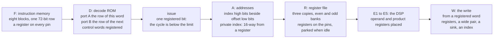

# The CSP, second revision: the machine

Copyright © 2026 Thor H. Linløkken <thj@thj.no>
License: CERN-OHL-S v2

*Draft for issue #231. How the chip runs the programs `csp2_isa.md`
describes; the rules it is built to are the measured ones of
`gowin_oss_notes.md` (section 0 grades every claim). The numbers here
are the GW2AR-18's as this project measured them, not the datasheet's
promise.*

## 0. The rules this machine is built to

Each of these cost the first revision a fault that took a day to find;
the second revision takes them as given.

1. **Nothing but a register on a block RAM's or DSP's pin.** The
   place-and-route tool times no path into or out of such a pin, and the
   silicon takes about 0.82 of what the tool reports for the fabric. The
   register sits beside the block, flip-flop by flip-flop
   (`csp_placed_dff`), and the block itself at a chosen site.
2. **No row read while written.** A block reads the row on its address
   pins on every clock, idle or not, and a row read on one port in the
   clock the other port writes it can lose the write. Idle read ports
   are parked on a row nothing writes; the probe and the write window
   are placed in cycles no instruction reads.
3. **Only a register cuts a path.** A mux rearranged in the RTL does not
   survive synthesis; depth is the synthesiser's view of the cone.
4. **The design meets 73.728 MHz on every seed, or it is redesigned.** A
   seed is a probe: when seeds differ, the fingerprint of what each
   loses names the path. The clock is the audio timebase and never
   moves.
5. **Three acceptances that do not imply one another**: the chip's own
   self-test with operands that change every pass (what the CSP
   computes), the register image read back (what the firmware wrote),
   and the baseline take through the Essentia comparison with the
   valley floor (what it sounds like). All three on every seed, from the
   first bitstream.

## 1. The pipeline

| stage | what happens | what is a register |
|---|---|---|
| F | the program counter addresses the eight instruction blocks; the row is in their output registers a clock later and in the fetch registers the clock after | the address on the pins, the row off the pins |
| D | the `op` field addresses the decode ROM's port A; port B is addressed by the next word's `op` (the fetch runs one ahead), so the front end holds this instruction's control word and the next's | both control words, on the ROM's output pins |
| issue | the instruction issues when the cycle is below the pass's limit; there is no other condition, because the schedule is the assembler's (ISA section 8) | one bit |
| A | each operand's address is formed by mode: direct, the index's high bits beside the offset, the immediate; the vector element's private index is one of sixteen registers chosen by the registered element number | the three addresses, into the banks' pin registers |
| R | the three copies of the file read the three operands; the words are in the banks' output registers two clocks later | the pins, in and out |
| E1–E5 | the multiply-add unit with its operand registers and its product register placed beside the DSP; the add, compare, select, min/max, logic and shift units in the fabric | every stage boundary |
| W | the result goes from a registered word into the file's write registers (every copy), or to a sink, or to an index register | the write port's pins |

The front end has no hazard check, no skip counter per element and no
64-way select: the depth that the first revision's seeds reported as
10–13 LUT levels into the private index register is here a block read
plus a 16-way select from a register. The result latency, the barrier
latency and the index latency are fixed numbers the assembler schedules
by; they are decided with the datapath's stage count and written into
both this document and the assembler when the RTL is.

## 2. The memories

| memory | blocks | ports | rule |
|---|---|---|---|
| instruction memory | 8 × (2048 × 9), one 72-bit row | A: the SPI load, held; B: the fetch | registers on both sides of the pins; loaded with the CSP held |
| decode ROM | 1 × (1024 × 18) | A: this word's row; B: the next word's | loaded with the program, as one image |
| register file | 6 × (1024 × 18): three read copies, each an even and an odd bank | A: the write (every copy); B: a read | parked on the inputs' last pair when no instruction reads; the write from a registered word; the probe reads on the pass's last cycle, after the window's last write has landed |
| write queue | 1 × (512 × 32) | A: the SPI write; B: the pop | the pop's address and entry through placed registers; the decoy slot |
| sink area | 12 × (1024 × 18) today: six replicas × two pages | A: the CSP's and the firmware's writes; B: a partial replica's read, every clock | hash `a7c5e1f8`: the partials read six replicas in parallel on every clock, which is what the twelve blocks are for; a wider row (two sinks a row, six blocks) or a different replica count is the one budget question of this revision, and the no-row-read-while-written rule holds here with the firmware's writes to both pages |

Thirty-five of the chip's forty-six blocks are in use at the end of the
first revision (the partial pipeline and the output take the rest); the
second revision adds four for the wide word and one for the ROM, and
takes back what the sink area's answer allows.

## 3. The budget

| resource | first revision (parked seed 4) | of | the second revision's direction |
|---|---|---|---|
| flip-flops | 12193 | 15552 (78 %) | the limit that bites first: the SVF's ~6000 reset flops serve nothing and go; the front end's per-element state shrinks by four |
| LUT4 | 10906 | 20736 (52 %) | the decoder's and the hazard check's LUTs go; the 16-way selects replace the 64-way |
| block RAM | 35 | 46 | +5, minus the sink area's answer |
| DSP | the multiply-add | | as is |

A slice is one LUT and one flip-flop: the flip-flop count is the
packing limit, which is why the first revision's last cut, five
registered candidates for the private index, could not be placed at 58 %
of the LUTs.

## 4. Placement

What is placed by hand, and why, as the first revision measured it:

- every block RAM and the DSP at a named site, their pin registers on
  the tiles beside them (`csp_bank`, `csp_program_slice`,
  `csp_write_queue`, `csp_multiply_add`): left to the placer, a pin
  register went where its logic was, up to fifty tiles away, a route of
  the order of the period;
- nothing else: the fabric between registers is the tool's to place and
  time, and the design gives it chains short enough that every seed
  meets the clock — the acceptance says whether it does.

Synthesis runs with `-nowidelut` (the wide-LUT clusters hang the
legaliser), the pinned bitstream generator, and the nextpnr with the
block RAM and DSP timing arcs (#230).

## 5. The pass

| cycles | what |
|---|---|
| 0 … 1471 | instructions issue, one a cycle at most, in the assembler's schedule |
| 1472 … 1481 | the pipeline drains |
| 1482 … 1529 | the write window: up to 48 of the firmware's queued writes, from the queue's placed registers into the file |
| 1530 … 1534 | the last writes land in the blocks |
| 1535 | the probe reads its pair (the Y port, unparked for the cycle); the pass counter's write is taken |

The sink pages flip at the pass boundary; the partials always read one
complete pass.

## 6. Loading and acceptance

The firmware holds the CSP, writes the instruction rows and the decode
ROM's rows as one image, writes the constants and the wiring through
the queue, and releases. Then, before the first note:

1. the **self-test**: a program of its own in the same image, run from
   the ROM, whose checks use operands that change every pass (`SHIFT`,
   `IDX`); the counts are printed and compared with the model's. A stale
   operand on any path shows here as a fraction of passes wrong;
2. **`csp-verify`**: every register the firmware wrote, read back through
   the probe; sent again while they differ, the count printed;
3. the **baseline take** through `tools/lab`: the Galaxy sequence
   recorded, checked with Essentia, compared with the benchmark's
   envelope, pitch classes, centroid, partials and valley floor.

A bitstream is accepted when all three pass at 73.728 MHz; a seed sweep
of a design change runs all three on every seed.

## 7. What the first revision taught, by fault

| fault | found by | the rule it became |
|---|---|---|
| a boot image with ONE zero, the synth silent | `csp-verify` | no row read while written (the probe's row); parked read ports |
| the queue losing a batch's first words | the dumps against the playing consensus | a register on the queue's address pin; the decoy |
| a stale operand on 15 % of passes, the arpeggio 11 % short, noise under the tone | the self-test's SHIFT/IDX counts; the valley floor | the front end's depth: a ROM, not a decoder; no hazard check; 16 not 64 |
| a store landing with address bits dropped | the five-word test | the write from a registered word; pin registers |
| the report's frequency sorting nothing | the seed table | the report is the fabric's; the silicon is 0.82 of it; nothing on a pin is timed |
| a mux rearranged, 10 → 17 levels | a build | only a register cuts a path |
