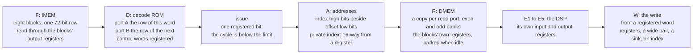

# The CSP, second revision: the machine

Copyright © 2026 Thor H. Linløkken <thj@thj.no>
License: CERN-OHL-S v2

*Draft for issue #231. How the chip runs the programs `csp2_isa.md`
describes; the rules it is built to are the measured ones of
`gowin_oss_notes.md` (section 0 grades every claim). The numbers here
are the GW2AR-18's as this project measured them, not the datasheet's
promise.*

## 0. The rules this machine is built to

Each of these cost the first revision a fault that took a day to find;
the second revision takes them as given.

1. **The block's own registers are the registers on its pins.** A block
   RAM samples its address, data and write enable on its clock and reads
   through its output register (UG285-1.4E p6, the read modes; DS226-2.7E
   p36, table 3-14: 0.31 ns from the output register against 2.26 ns from
   the address); the DSP has input, pipeline and output registers
   (UG287-1.4E p6, table 3-2; p30, table 4-10; the blocks as graphs in
   `gowin_primitives.md`). The logic before a pin
   ends in an ordinary flip-flop, which the nextpnr with the block RAM
   and DSP timing arcs (#230) times; the silicon takes about 0.82 of what
   the tool reports for the fabric. Nothing is placed by hand: the first
   revision's fabric registers beside every block were a workaround for
   a tool that timed no pin path, and with the patched tool and no
   constraints its memories came through four boots of four. The one
   path that did not, the DSP's operands, is measured again here; if the
   acceptance wants those registers beside the block, that is one
   measured exception, not a building block.
2. **No row read while written.** A block reads the row on its address
   pins on every clock, idle or not, and a row read on one port in the
   clock the other port writes it can lose the write — "performing read
   and write operations to the same address at the same time is not
   allowed" (UG285-1.4E p6 and p24, note 1), found on the board before it
   was found in the document. Idle read ports are parked on a row
   nothing writes; the probe and the write window are placed in cycles no
   instruction reads. Two clocks on one block are allowed and used (the
   FIFO, IMEM's load, the sink pages): with two clocks "the same time"
   is any overlap of edges, so each such block states why its two ports
   never meet on a row — pointers that cannot coincide, a fetch port
   parked during the load, a page nothing reads while it is written. A
   row polled on one clock and written on the other is forbidden by the
   same sentence; single bits (the commit, the hold, the test tone, the
   read pointer back) cross through flip-flops.
3. **Only a register cuts a path.** A mux rearranged in the RTL does not
   survive synthesis; depth is the synthesiser's view of the cone.
4. **The design meets 73.728 MHz on every seed, or it is redesigned.** A
   seed is a probe: when seeds differ, the fingerprint of what each
   loses names the path. The clock is the audio timebase and never
   moves.
5. **Three acceptances that do not imply one another**: the chip's own
   self-test with operands that change every pass (what the CSP
   computes), the register image read back (what the firmware wrote),
   and the baseline take through the Essentia comparison with the
   valley floor (what it sounds like). All three on every seed, from the
   first bitstream.

## 1. The pipeline

| stage | what happens | what is a register |
|---|---|---|
| F | the program counter, a register, addresses the eight IMEM blocks; the row is in their output registers a clock later | the program counter; the blocks' output registers |
| D | the `op` field addresses the decode ROM's port A; port B is addressed by the next word's `op` (the fetch runs one ahead), so the front end holds this instruction's control word and the next's | both control words, in the ROM's output registers |
| issue | the instruction issues when the cycle is below the pass's limit; there is no other condition, because the schedule is the assembler's (ISA section 8) | one bit |
| A | each operand's address is formed by mode: direct, the index's high bits beside the offset, the immediate; the vector element's private index is one of sixteen registers chosen by the registered element number | the addresses, as registers |
| R | DMEM's copies read the operands; the words are in the blocks' output registers a clock later | the blocks' address and output registers |
| E1–E5 | the multiply-add in the DSP, operands into its input registers and the sum out of its output register; the add, compare, select, min/max, logic and shift units in the fabric | every stage boundary |
| W | the result goes from a registered word into DMEM (every copy), or to a sink, or to an index register | the word; the blocks' write registers |

The front end has no hazard check, no skip counter per element and no
64-way select: the depth that the first revision's seeds reported as
10–13 LUT levels into the private index register is here a block read
plus a 16-way select from a register. The result latency, the barrier
latency and the index latency are fixed numbers the assembler schedules
by; they are decided with the datapath's stage count and written into
both this document and the assembler when the RTL is.

## 2. The memories

| memory | blocks | ports | rule |
|---|---|---|---|
| IMEM, the instruction memory | 8 × (2048 × 9): eight 9-bit slices of one 72-bit row, the same address on all eight, not replicas | A: the SPI load on the SPI clock, with the CSP held; B: the fetch | a dual-clocked block: the load crosses no logic; a row is two 36-bit quads on the wire (`memory_map.md`) |
| decode ROM | 1 × (1024 × 18) | A: this word's row; B: the next word's | loaded with the program, as one image |
| DMEM, the data memory | (1024 × 18) blocks: a copy per read port, each an even and an odd bank for the aligned pairs — two reads a cycle is four blocks, three is six; the datapath decides | A: the write (every copy); B: a read | parked on a row nothing writes when no instruction reads; the write from a registered word; the probe reads on the pass's last cycle, after the window's last write has landed |
| the write FIFO | 1 × (512 × 36), holding 511: one 36-bit wire quad an entry | A: the SPI write, on the SPI clock; B: the pop | the one queue in the system (the firmware keeps a *pending* bit per word, no queue of its own): it crosses the clocks, lands a group of writes in one pass, and holds the boot image while it lands 48 a pass; its depth is a size. The two ports never meet: the pointers cannot coincide on a row that holds data, and when the FIFO is empty the read port idles one row *behind* the head, not on the row the next write takes — the first revision idled on the head and hid the lost first word behind a decoy write. Landscaping to consider under the map's rule: a port of the firmware's own into DMEM would leave only the crossing |
| sink area | 12 × (1024 × 18) today: six replicas × two pages | A: the CSP's and the firmware's writes, to the shadow page only; B: a partial replica's read of the active page, every clock | the double buffer: the partials read the active page on every clock, so nothing writes it; the CSP and the firmware write the shadow page and the pages swap at the pass boundary (the firmware's words, which the first revision wrote to both pages, go the same way and are taken over at the swap). Six replicas because the partials read six sinks in parallel on every clock; decided on #231 to stay as it is, twelve blocks |

Thirty-five of the chip's forty-six blocks are in use at the end of the
first revision (the partial pipeline and the output take the rest); the
second revision adds four for the wide word and one for the ROM, and
takes back two if DMEM needs two read ports rather than three: 38 or 40
of 46.

## 3. The budget

| resource | first revision (parked seed 4) | of | the second revision's direction |
|---|---|---|---|
| flip-flops | 12193 | 15552 (78 %) | the limit that bites first: the SVF's ~6000 reset flops serve nothing and go; the front end's per-element state shrinks by four |
| LUT4 | 10906 | 20736 (52 %) | the decoder's and the hazard check's LUTs go; the 16-way selects replace the 64-way |
| block RAM | 35 | 46 | +5 (four IMEM slices, the ROM): 40, or 38 with a two-port DMEM |
| DSP | the multiply-add | | as is |

A slice is one LUT4 and one flip-flop, and the chip has six usable
flip-flops for every eight LUTs: the fourth slice pair of each unit has
registers that need a patch from Gowin (DS226-2.7E p9, figure 2-2;
`gowin_primitives.md` section 4), so 2592 units give 20 736 LUT4 and
15 552 flip-flops. The flip-flop count is the packing limit, which is why
the first revision's last cut, five registered candidates for the
private index, could not be placed at 58 % of the LUTs.

## 4. Placement and the flow

Nothing is placed by hand. The blocks' own registers are the pin
registers (rule 1), the fabric between registers is the tool's to place
and time, and the design gives it chains short enough that every seed
meets the clock — the acceptance says whether it does. The first
revision placed a fabric register beside every block pin, flip-flop by
flip-flop, and measured the rule as *observed*, not proved
(`gowin_oss_notes.md` section 0): the second revision does not inherit
it. The one path it measured as failing without placement, the DSP's
operands, is where the acceptance looks first.

The flow is the pinned bitstream generator and the nextpnr with the
block RAM and DSP timing arcs (#230). Synthesis starts *without*
`-nowidelut`: the first revision added it when its netlists, already
carrying the placed registers and the 64-way selects, hung the
legaliser on the wide-LUT clusters; whether a simpler netlist places
with them was never tried. The flag comes back only if this netlist
hangs — measured, not inherited.

## 5. The pass

| cycles | what |
|---|---|
| 0 … 1471 | instructions issue, one a cycle at most, in the assembler's schedule |
| 1472 … 1481 | the pipeline drains |
| 1482 … 1529 | the write window: up to 48 of the firmware's writes popped from the FIFO; each lands in DMEM two cycles after its pop, 1484 … 1531 |
| 1530 … 1534 | the last writes land in the blocks |
| 1535 | the probe reads its pair (the Y port, unparked for the cycle); the pass counter's write is taken |

The sink pages flip at the pass boundary; the partials always read one
complete pass.

## 6. Loading and acceptance

The firmware holds the CSP, writes the instruction rows and the decode
ROM's rows as one image, writes the wiring through the FIFO, and
releases; the wire is in nines (a 9-bit command, an 18-bit address,
36-bit quads: `memory_map.md`, conventions), so every quad is one row of
one block. Then, before the first note:

1. the **self-test**: a program of its own in the same image, run from
   the ROM, whose checks use operands that change every pass (`SHIFT`,
   `IDX`); the counts are printed and compared with the model's. A stale
   operand on any path shows here as a fraction of passes wrong;
2. **`csp-verify`**: every register the firmware wrote, read back through
   the probe; sent again while they differ, the count printed;
3. the **baseline take** through `tools/lab`: the Galaxy sequence
   recorded, checked with Essentia, compared with the benchmark's
   envelope, pitch classes, centroid, partials and valley floor.

A bitstream is accepted when all three pass at 73.728 MHz; a seed sweep
of a design change runs all three on every seed.

## 7. What the first revision taught, by fault

| fault | found by | the rule it became |
|---|---|---|
| a boot image with ONE zero, the synth silent | `csp-verify` | no row read while written (the probe's row); parked read ports |
| the FIFO losing a batch's first words | the dumps against the playing consensus | the idle read port was on the row the next write took (rule 2); it idles one row behind, and the decoy write goes |
| a stale operand on 15 % of passes, the arpeggio 11 % short, noise under the tone | the self-test's SHIFT/IDX counts; the valley floor | the front end's depth: a ROM, not a decoder; no hazard check; 16 not 64 |
| a store landing with address bits dropped | the five-word test | the write from a registered word |
| the report's frequency sorting nothing | the seed table | the report is the fabric's; the silicon is 0.82 of it; the pin arcs come from the patched tool (#230) |
| a mux rearranged, 10 → 17 levels | a build | only a register cuts a path |
