# The CSP, second revision: the machine

Copyright © 2026 Thor H. Linløkken <thj@thj.no>
License: CERN-OHL-S v2

*Draft for issue #231. How the chip runs the programs `csp2_isa.md`
describes; the rules it is built to are the measured ones of
`gowin_oss_notes.md` (section 0 grades every claim). The numbers here
are the GW2AR-18's as this project measured them, not the datasheet's
promise.*

## 0. The rules this machine is built to

Each of these cost the first revision a fault that took a day to find;
the second revision takes them as given.

1. **The block's own registers are the registers on its pins.** A block
   RAM samples its address, data and write enable on its clock and reads
   through its output register (UG285-1.4E p6, the read modes; DS226-2.7E
   p36, table 3-14: 0.31 ns from the output register against 2.26 ns from
   the address); the DSP has input, pipeline and output registers
   (UG287-1.4E p6, table 3-2; p30, table 4-10; the blocks as graphs in
   `gowin_primitives.md`). The logic before a pin
   ends in an ordinary flip-flop, which the nextpnr with the block RAM
   and DSP timing arcs (#230) times; the silicon takes about 0.82 of what
   the tool reports for the fabric. Nothing is placed by hand: the first
   revision's fabric registers beside every block were a workaround for
   a tool that timed no pin path, and with the patched tool and no
   constraints its memories came through four boots of four. The one
   path that did not, the DSP's operands, is measured again here; if the
   acceptance wants those registers beside the block, that is one
   measured exception, not a building block.
2. **No row read while written.** A block reads the row on its address
   pins on every clock, idle or not, and a row read on one port in the
   clock the other port writes it can lose the write — "performing read
   and write operations to the same address at the same time is not
   allowed" (UG285-1.4E p6 and p24, note 1), found on the board before it
   was found in the document. Idle read ports are parked on a row
   nothing writes; the probe and the write window are placed in cycles no
   instruction reads. Two clocks on one block are allowed and used (the
   FIFO, IMEM's load, the sink pages): with two clocks "the same time"
   is any overlap of edges, so each such block states why its two ports
   never meet on a row — pointers that cannot coincide, a fetch port
   parked during the load, a page nothing reads while it is written. A
   row polled on one clock and written on the other is forbidden by the
   same sentence; single bits (the commit, the hold, the test tone, the
   read pointer back) cross through flip-flops.
3. **Only a register cuts a path.** A mux rearranged in the RTL does not
   survive synthesis; depth is the synthesiser's view of the cone.
4. **The design meets 73.728 MHz on every seed, or it is redesigned.** A
   seed is a probe: when seeds differ, the fingerprint of what each
   loses names the path. The clock is the audio timebase and never
   moves.
5. **Three acceptances that do not imply one another**: the chip's own
   self-test with operands that change every pass (what the CSP
   computes), the register image read back (what the firmware wrote),
   and the baseline take through the Essentia comparison with the
   valley floor (what it sounds like). All three on every seed, from the
   first bitstream.

## 1. The pipeline

```mermaid
flowchart LR
    F[F: the program counter, IMEM's pin register] --> D1[D1: IMEM's output register<br/>captured; the op field into<br/>the ROM's address register]
    D1 --> D2[D2: the ROM's address pins<br/>driven from that register]
    D2 --> D3[D3: the ROM's output register<br/>captured]
    D3 --> A[A: the control word in a register of ours<br/>operand addresses: index bits beside offset bits<br/>loops pushed and ended, indexes stepped]
    A --> R1[R1: DMEM's three copies<br/>read pins are registers<br/>idle ports and banks parked]
    R1 --> R2[R2: the words in the blocks' output registers<br/>a SKIP decides]
    R2 --> E1[E1: the words picked and formatted<br/>IDX written]
    E1 --> E1b[E1b: the arithmetic<br/>the DSP's operands into registers<br/>logic unit, shifter prepared]
    E1b --> E2[E2: the DSP's own input registers sample<br/>the operand registers, nothing between]
    E2 --> E3[E3: the DSP computes<br/>the shifter's coarse stage]
    E3 --> E4[E4: the product captured<br/>the shifter's fine stage]
    E4 --> E5[E5: reduced, saturated or wrapped<br/>flags and accumulator written]
    E5 --> W[W: write pins are registers<br/>the write lands at the next edge]
```

A row presented to IMEM in cycle *k* is in A in *k*+4, the cycle the assembler
calls its issue (`FIRST_ISSUE_CYCLE`, 4, for the program's first row); the
cycles below count from there.

| stage | cycle | what happens | what is a register |
|---|---|---|---|
| F | −4 | the program counter, a register, drives IMEM's address pins | the program counter |
| D1 | −3 | IMEM's output register holds the row; a register takes it, and its op field into the ROM's address register (parked while held) | IMEM's own register; the row, its pc, the ROM's pin register |
| D2 | −2 | the ROM's address pins are driven from that register | the ROM's own register |
| D3 | −1 | the ROM's output register holds the control word; a register takes it | the control word, captured |
| A | 0 | the control word is out of the ROM's register; each operand's address is formed by mode (direct, the index's bits beside the offset's, the immediate); a `LOOP` is pushed, a loop's last row repeats or ends it and steps its index register; the read rows of DMEM's banks are chosen, the idle banks parked | the addresses, the control word, the row's fields, DMEM's read pins |
| R1 | 1 | DMEM's three copies sample their pins | the blocks' own |
| R2 | 2 | the words are in the blocks' output registers; registers take them as they come; a `SKIP` reads the flags and kills the two rows behind it | the words, captured |
| E1 | 3 | the words picked (the odd or even half, or the immediate) and formatted; an `IDX` written | the operands |
| E1b | 4 | A and Y in the accumulator's format; the multiply-add's operands formed (INTERP's difference and ADD3's sum saturated here); MIN, MAX, SEL and ANDXOR; the shifter's count worked out | the multiply-add's operand registers; the logic result, the shifter's inputs |
| E2 | 5 | the block's input registers sample the operand registers | the block's own input registers |
| E3 | 6 | the multiply-add computes; the shifter's coarse stage | the block's own output register; the shifter |
| E4 | 7 | the product is out of the block and captured; the shifter's fine stage | the product, captured |
| E5 | 8 | the sum reduced to its destination, saturated or wrapped; the flags and the accumulator written; DMEM's write enables, row and words decoded | the flags and the accumulator; the write registers |
| W | 9 | the write registers drive DMEM's write pins (or a sink word's); the write lands at the edge after | the registers on the pins |

The numbers the assembler schedules by follow from the table. A result is
readable by a row issued **9** cycles after the row that wrote it (its read
pins are driven at 1, the write is sampled at the end of 9, so a reader at
issue + 9 samples one edge later and never meets it on a row). The flags
and the accumulator are in their registers from cycle 9, which a `SEL`
reads in its E1b (4) and a `SKIP` in its R2 (2): a reader of either issues
5 and **7** cycles after the writer; the assembler takes 7 for both. An
`IDX` writes its index at the end of its E1; a row's A reads it **4**
cycles after the `IDX` issues, the three rows between being NOPs the
assembler lays itself. A loop's repeat is decided in A and redirects the
program counter: the four rows behind the loop's last, in D3, D2, D1 and F,
are discarded, so a repeat costs **4** cycles. A vector loop's row is known
in D2, from the op field captured in D1 (the ROM's rows 1 and 2 are the
vector loops'), one cycle after the body's first row went out for element
0: the row fetched in that cycle is killed, and from then on the front end
fetches each body row once an element of the round, the element's number
riding down the pipeline with the row — **1** bubble to enter, **0** to
leave. The decision in D2 is compares and muxes on registered values: the
row's numbers as the assembler laid them (the body's last row in `imm`,
the first round from the count's high bits), the row after the one in D2
registered a stage before, the round's last element kept rather than its
size; a scalar loop's repeat is not in the decision's head — it has its
priority at the program counter's mux and the state keeps nothing from a
row it kills (#238: with the repeat and the subtractions in the chain this
path was the chip's longest, 11 levels). In A the loop's own index is the element's (the base stepped by the
stride, by element); the other index and the flags are the element's
private copies, sixteen of each, written by its own `IDX` (E1) and `CMP`
(E5) and read through to the registers until then; the last element's
land in the registers too.

No block RAM output feeds logic and no logic feeds a block RAM pin: IMEM's
row, the ROM's control word, DMEM's words and the write FIFO's head are each
captured by a register before anything reads them, and the ROM's address
register and DMEM's read registers are the pins. A block's pins have a
register of their own: the program counter's next value is registered in
each of IMEM's eight slices, DMEM's write in each bank of each copy, the
sink area's write in each of its blocks (`keep`, or yosys merges the copies).
The tool times no path into a pin, and one register driving six blocks'
pins across the chip dropped an address bit on some boots (#238: a voice's
level written 0x400 low; the first revision's fault, met again).

E2 exists so that nothing but a register is in front of the DSP's input pins:
the logic before a block's pin is not timed (rule 1), and E1b's operand logic, the
55-bit subtract of INTERP among it, is the longest in the core (with the operand
pick in the same stage the report fell from 160 to 90 MHz, which is why E1 and
E1b are two). The first version of
this core formed the operands in E1 straight into the pins; what the board made of
that, and of this, is in section 4.

The front end has no hazard check, no stall, no skip counter per element
and no 64-way select: the depth that the first revision's seeds reported as
10–13 LUT levels into the private index register is here a block read
plus short selects from registers. The latencies are the assembler's and the
model's (`csp.hpp`: `result_latency`, `state_latency`, `index_latency`,
`jump_penalty`) and the RTL's (`csp_pkg.sv`); the co-simulation checks that
the chip issues in the cycle the model counts.

## 2. The memories

| memory | blocks | ports | rule |
|---|---|---|---|
| IMEM, the instruction memory | 8 × (2048 × 9): eight 9-bit slices of one 72-bit row, the same address on all eight, not replicas | A: the SPI load on the SPI clock, with the CSP held; B: the fetch | a dual-clocked block: the load crosses no logic; a row is two 36-bit dwords on the wire (`memory_map.md`) |
| decode ROM | 1 × (1024 × 18) | A: this word's row; B: the next word's | loaded with the program, as one image |
| DMEM, the data memory | 6 × (1024 × 18): a copy for each of the three read ports (R, X and Y), each an even and an odd bank for the aligned pairs; every copy takes every write | A: the write (every copy); B: a read | parked on a row nothing writes when no instruction reads; the write from a registered word; the probe reads on the pass's last cycle, after the window's last write has landed |
| the write FIFO | 1 × (512 × 36), holding 511: one 36-bit wire dword an entry | A: the SPI write, on the SPI clock; B: the pop | the one queue in the system (the firmware keeps a *pending* bit per word, no queue of its own): it crosses the clocks, lands a group of writes in one pass, and holds the boot image while it lands 48 a pass; its depth is a size. The two ports never meet: the pointers cannot coincide on a row that holds data, and when the FIFO is empty the read port idles one row *behind* the head, not on the row the next write takes — the first revision idled on the head and hid the lost first word behind a decoy write. Landscaping to consider under the map's rule: a port of the firmware's own into DMEM would leave only the crossing |
| sink area | 12 × (1024 × 18) today: six replicas × two pages | A: the CSP's writes to the shadow page, the firmware's (through the pass's window) to both pages, so that a flip keeps them; B: a partial replica's read of the active page, every clock | the double buffer: the partials read the active page on every clock, so nothing writes it; the CSP and the firmware write the shadow page and the pages swap at the pass boundary (the firmware's words, which the first revision wrote to both pages, go the same way and are taken over at the swap). Six replicas because the partials read six sinks in parallel on every clock; decided on #231 to stay as it is, twelve blocks |

Thirty-five of the chip's forty-six blocks are in use at the end of the
first revision (the partial pipeline and the output take the rest); the
second revision adds four for the wide word and one for the ROM, and
takes back two if DMEM needs two read ports rather than three: 38 or 40
of 46.

## 3. The budget

| resource | first revision (parked seed 4) | of | the second revision's direction |
|---|---|---|---|
| flip-flops | 12193 | 15552 (78 %) | the limit that bites first: the SVF's ~6000 reset flops serve nothing and go; the front end's per-element state shrinks by four |
| LUT4 | 10906 | 20736 (52 %) | the decoder's and the hazard check's LUTs go; the 16-way selects replace the 64-way |
| block RAM | 35 | 46 | +5 (four IMEM slices, the ROM): 40, or 38 with a two-port DMEM |
| DSP | the multiply-add | | as is |

A slice is one LUT4 and one flip-flop, and the chip has six usable
flip-flops for every eight LUTs: the fourth slice pair of each unit has
registers that need a patch from Gowin (DS226-2.7E p9, figure 2-2;
`gowin_primitives.md` section 4), so 2592 units give 20 736 LUT4 and
15 552 flip-flops. The flip-flop count is the packing limit, which is why
the first revision's last cut, five registered candidates for the
private index, could not be placed at 58 % of the LUTs.

## 4. Placement and the flow

Nothing is placed by hand. The blocks' own registers are the pin
registers (rule 1), the fabric between registers is the tool's to place
and time, and the design gives it chains short enough that every seed
meets the clock — the acceptance says whether it does. The first
revision placed a fabric register beside every block pin, flip-flop by
flip-flop, and measured the rule as *observed*, not proved
(`gowin_oss_notes.md` section 0): the second revision does not inherit
it. The one path it measured as failing without placement, the DSP's
operands, is where the acceptance looks first.

The flow is the pinned bitstream generator and the nextpnr with the
block RAM and DSP timing arcs (#230). Synthesis starts *without*
`-nowidelut`: the first revision added it when its netlists, already
carrying the placed registers and the 64-way selects, hung the
legaliser on the wide-LUT clusters; whether a simpler netlist places
with them was never tried. The flag comes back only if this netlist
hangs — measured, not inherited.

## 5. The pass

| cycles | what |
|---|---|
| 0 … 1471 | instructions issue, one a cycle at most, in the assembler's schedule |
| 1472 … 1481 | the pipeline drains |
| 1482 … 1529 | the write window: up to 48 of the firmware's writes popped from the FIFO; each is on the FIFO's head two cycles after its pop (1484 … 1531), a register of `csp_pass` takes it, the core's write registers the cycle after, and DMEM samples it one cycle on, 1486 … 1533 |
| 1533 | the pass counter, for the next pass, is asked for through the same registers (sampled at 1534) into input register 0x040 — while the CSP runs; held, the register keeps the number of the pass after the last one that ran, so a frozen chip's state matches the model's |
| 1534 | the probe asks for its pair: the R copy's read registers take the probe's row |
| 1535 | the probe's read pins are driven from those registers; its words are out in the cycle after, the next pass's first |

Every DMEM pin, read and write, is a register of the core's: the rows with the
parked ones already chosen, the banks' enables already decoded (a word write takes one
bank, a wide one both, register 0 neither). The logic before a block's pin is the one
path the tool does not time (rule 1); the first version of this core had a write mux
and the address-zero decode between its registers and the pins, and its first board
run failed at 102 MHz against a report of 161.

The sink pages flip at the pass boundary; the partials always read one
complete pass.

## 6. Loading and acceptance

The firmware holds the CSP, writes the instruction rows and the decode
ROM's rows as one image, writes the wiring through the FIFO, and
releases; the wire is in nines (a 9-bit command, an 18-bit address,
36-bit dwords: `memory_map.md`, conventions), so every dword is one row of
one block. The register file outlives the firmware's reset, so the boot
zeroes every register between the self-test and the image, and the image
wires every channel and voice the program's loops run (their counts are
the program's, `counts.s`), used or not: a loop runs every element with
whatever its registers hold. Then, before the first note:

1. the **self-test**: a program of its own in the same image, run from
   the ROM, whose checks use operands that change every pass (`SHIFT`,
   `IDX`); the counts are printed and compared with the model's. A stale
   operand on any path shows here as a fraction of passes wrong;
2. **`csp-verify`**: every register the firmware wrote, read back through
   the probe; sent again while they differ, the count printed;
3. the **baseline take** through `tools/lab`: the Galaxy sequence
   recorded, checked with Essentia, compared with the benchmark's
   envelope, pitch classes, centroid, partials and valley floor.

A bitstream is accepted when all three pass at 73.728 MHz; a seed sweep
of a design change runs all three on every seed. `tools/lab/acceptance.py`
runs the three on the board as one command (the bitstream loaded, the
firmware reset, the patch loaded, the sequence recorded, checked and
compared) and writes the recording, the tables, the plot, the M4A and a
`verdict.json` to a directory; its exit status is the verdict.

## 7. What the first revision taught, by fault

| fault | found by | the rule it became |
|---|---|---|
| a boot image with ONE zero, the synth silent | `csp-verify` | no row read while written (the probe's row); parked read ports |
| the FIFO losing a batch's first words | the dumps against the playing consensus | the idle read port was on the row the next write took (rule 2); it idles one row behind, and the decoy write goes |
| a stale operand on 15 % of passes, the arpeggio 11 % short, noise under the tone | the self-test's SHIFT/IDX counts; the valley floor | the front end's depth: a ROM, not a decoder; no hazard check; 16 not 64 |
| a store landing with address bits dropped | the five-word test | the write from a registered word |
| the report's frequency sorting nothing | the seed table | the report is the fabric's; the silicon is 0.82 of it; the pin arcs come from the patched tool (#230) |
| a mux rearranged, 10 → 17 levels | a build | only a register cuts a path |
