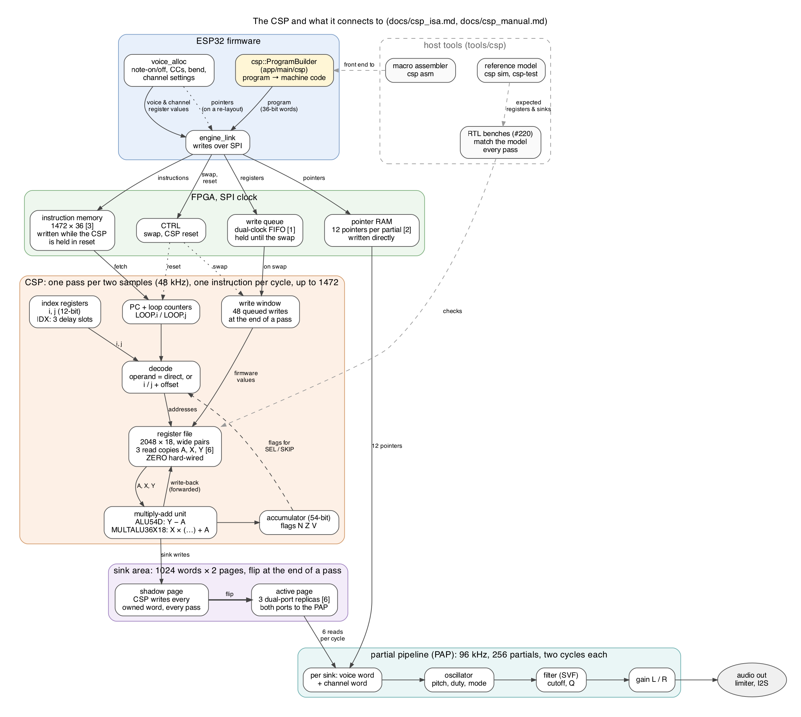

# CSP instruction set — design proposal

Copyright © 2026 Thor H. Linløkken <thj@thj.no>
License: CERN-OHL-S v2

**Status: design decided (#184): the instruction set in
[csp_manual.md](csp_manual.md) is approved, and the decisions are
listed in section 14. The core is built (#220) as the pipeline of
section 3: it matches the reference model in co-simulation and meets
timing, but is not wired into the synthesizer yet. Vector loops
(section 3) are decided (#220) and built: they match the model in
cycles as well as in results.** The
current CSP is described in [dmem_architecture.md](dmem_architecture.md);
this document proposes what it becomes and why. The instruction set
itself, every instruction and the assembly language, is specified in
[csp_manual.md](csp_manual.md). Cycle counts and resources here are
measured (reference model, `make csp-fit`); counts of words and
instructions are worked out from the layouts.

The Control Signal Processor (CSP) computes every control signal the
partial pipeline reads: envelopes, LFOs, pitch, cutoff, gain. The aim is
a small, general processor in the spirit of the EMU10K1's DSP (16
opcodes, a fixed program run once per sample), so that channel-wide and
voice-level arithmetic runs on the FPGA and the partials only point at
the results.



*The map: firmware, SPI, the CSP, the sink area and the partial
pipeline, with the BSRAM each part uses in brackets. Source:
`images/csp_map.dot`.*

Terms: a **channel** is a MIDI channel and everything set on it (the
current sound's settings, its LFOs, pitch bend, CCs). A **voice** is one
sounding note on a channel. A **partial** is one oscillator + filter +
gain slot in the partial pipeline; a voice has 8.

## 1. Where it stood

What this document started from: the **old CSP** on main (7c959b4),
which the new core replaces. Its figures below are the old ones, not
those of the new core (a program of up to 1472 instructions per pass,
section 2).

- **Program (old):** 256 instructions, one per cycle, then a 5-cycle
  drain: 261 of the 768 cycles in a sample (73.728 MHz / 96 kHz). The
  firmware uses 99 entries.
- **Opcodes:** a 4-bit enable mask (source, state, multiply, accumulate)
  giving three instructions: `LFO` (an `osc_core` on a phase in
  `state_mem`), `ADSR` (`adsr.sv`: the RC recurrence on an ALU54D and a
  MULTALU36X18) and `MAC` (source × COEF onto a target).
- **Operands:** a target and a source DMEM address in the OP word, and
  three immediates (`RATE_AD`, `COEF`, `RATE_DSR`) in their own RAMs.
- **DMEM:** 512 × 18-bit words, ping-pong paged per sample: the CSP
  writes one page while the partial pipeline reads the other. The
  firmware uses 102 words.
- **Partials:** each partial sink adds an immediate from the partial's
  own parameter words and one DMEM word. Every note-on writes 5 words to
  each of the voice's 8 partials (pitch, duty, cutoff, gain, gate).
- **Firmware writes** to DMEM wait in a one-word mailbox for a cycle in
  which the CSP is not writing back (`csp.sv`, `dmem_mbox_take`). The
  longest run of write-backs is 96 cycles (1.3 µs) against 3.2 µs per
  SPI word.

What is fixed-function today and becomes ordinary instructions: the
envelope state machine, the LFO waveform generator, "DMEM words only
add", and the per-partial immediates.

## 2. Execution model

- **One pass per two samples: 48 kHz** (decided, #184). The partial
  pipeline runs at 96 kHz for oscillator aliasing and filter headroom;
  control signals do not need it. A pass has 1536 cycles.
- **One fixed program per pass**, run from the top at every pass, one
  instruction after the other, no branches. Instructions issue in the
  first **1472 cycles**, at most one per cycle (section 3).
  Conditional work uses selects and `SKIP` (a skipped instruction still
  takes its cycle), and loops (`LOOP`) have a fixed count, so every pass
  runs the same instructions. Their waits (section 3) depend on which
  registers they touch; where an address comes from data (`IDX`), so can
  a wait. The reference model counts them exactly and checks the pass
  limit every pass.
- **Slower work alternates.** Work that runs slower still (LFOs at a
  quarter of 96 kHz) cannot come from skipping, since skipped
  instructions still take their cycles; a loop covers half the channels
  and `i` starts on the other half on alternate passes.
- **Firmware writes ride the swap.** The firmware's register writes go
  into a queue, as its partial-parameter writes go to the shadow page.
  When it toggles the CTRL swap, the queued writes are applied in a
  window at the end of the next pass, and the partial pages swap at the
  same boundary. A note-on's partial words and register words (note,
  velocity, gate) become visible in the same pass, and the CSP's write
  port is never shared mid-pass. The window takes 48 writes; a larger
  group spreads over several passes. 1472 cycles of instructions + a
  56-cycle window + drain = 1536.
- **Programs load with the CSP held in reset.** The instruction memory
  has one page: the firmware holds the CSP in reset, writes the program,
  and releases it, so a pass never runs half an old and half a new
  program. Changing the program is rare (start-up, a new routing), so
  the CSP pausing for it is acceptable. A reset clears no registers:
  constants, settings and running state survive a program load.
- **Results are visible at once:** an instruction reads the newest value
  of every register, including one written by the instruction just
  before it. The pipeline's interlocks make it wait for that value
  (section 3); there are no delay slots.
- **Published per pass:** the partial pipeline reads a separate,
  ping-pong-paged **sink area** (section 6), swapped at the end of each
  pass, so it always sees one complete pass. The CSP's own registers are
  not paged: like the EMU10K1's GPRs, they are read and written in place.

## 3. Datapath

An in-order pipeline with full interlocks and no forwarding (#220). A
program behaves as on a linear machine; an instruction that needs a
value still in the pipeline waits in decode until it has been written.

| Stage | Work |
|---|---|
| D | decode: operand addresses from `i`/`j`, the hazard check; the register-file read addresses go in as the instruction issues |
| R | register read (three ports) → operands in the accumulator's format; `SKIP` decides |
| E1 | `Y − A` and `A + Y` (55 bits); `MIN`, `MAX`, `SEL`, `ANDXOR`; the `SHIFT` barrel shift; `LOOP` and `IDX` resolve |
| E2 | saturate `Y − A` to Q4.32 and `A + Y` to 54 bits; the multiplier's operands; `SHIFT` saturates |
| E3 | MULTALU36X18: `a × b + c` |
| E4 | overflow of the 54-bit sum; saturate or wrap to the destination; the flags |
| W | write R (register file or sink area); the accumulator and the flags |

A dependent instruction issues 7 cycles after the one it depends on; the
instruction after `LOOP` or `IDX` issues 3 cycles after it
(`csp::result_latency`, `csp::barrier_latency`; the model counts both).
Independent instructions issue every cycle. There is no forwarding: it
would shorten the 7 cycles but lengthen the paths, and vector loops
(below) hide the wait instead.

**Measured** (`make csp-fit`, the CSP alone on the GW2A, seed 1): 98.15
MHz against the 73.728 MHz system clock; LUT4 5319, DFF 1697, BSRAM 10,
one MULTALU36X18. Without vector loops it was 91 MHz, with 3827 LUT4
and 1522 DFF. The slowest path is the next-pc logic (the loop records,
into the instruction memory's address); comparing each loop's last pc,
not the pc after it, keeps the increment out of the comparison. The
first try, a two-cycle machine without a pipeline (each instruction
finished before the next), closed at 32.48 MHz.

**Vector loops** (decided on #220, built). A chain of
dependent instructions costs 7 cycles a link, but the same chain for
many voices need not wait at all: run each instruction for every voice
before the next, and voice k's input was written long before voice k
needs it. That is a vector processor in the Cray sense, one element
per cycle through a deep pipeline (Asanović, *Vector
Microprocessors*, Berkeley 1998; the line continues in Hwacha and the
RISC-V V extension). `LOOP.vi` / `LOOP.vj` (`a` bit 1 of `LOOP`) run
their body that way. The body is still written per element, and each
element keeps its own flags and its own copy of the index register the
loop does not step, so `CMP` → `SEL` and `IDX j` → `[j+…]` work per
element. With 7 or more elements nothing waits. The hardware cost
is an element counter in the sequencer, two small LUT RAMs for the
per-element flags (3 bits) and index register (12 bits), up to 64
elements, and the run and element number carried by every instruction
in flight, for the hazard check (a flag reader waits for its own
element's flag setter; an operand indexed by the private register
waits while that element's `IDX` is in R or E1). The body runs
instruction by instruction, so an element has written its flags or
index register exactly when an earlier body instruction that writes
it has issued for every element: two bits per loop say so, and until
then the elements see the values the loop was entered with. Measured
on the model and the RTL alike, a one-instruction envelope step for 32
voices (the manual's example, section 8 there) takes 294 cycles per pass
as a vector loop and 1126 as a `LOOP`. About
1500 LUT4 more than the scalar core (section 3 above).

- **One multiply-add unit**: one MULTALU36X18 computes `a × b + c`;
  `INTERP`'s `Y − A` and `ADD3`'s `A + Y` are fabric adders in E1, and
  the saturations are fabric logic in E2 and E4. `MAC`, `INTERP` and
  the envelope recurrence are all `A + X × (Y − A)` or `A + X × Y` on
  it. The CSP's separate 18 × 18 multiply retires.
- **Accumulator:** 54 bits inside the DSP macro (Q8.46: a Q4.32 × Q4.14
  product). 72 bits is possible by chaining macros if a use for
  it turns up.
- **Condition flags** (zero, negative, saturated), set by every
  arithmetic instruction, read by `SEL` and `SKIP`.
- **Index registers `i` and `j`** and a **loop counter** beside the PC
  (section 4). An indexed operand's address is formed in decode.
- **PC, loop counter, instruction register, decoder, index registers,
  register file, ALU, flags, accumulator** become separate, named units
  in the RTL, each with its own bench (#220, next). Today the register
  file, instruction memory and write queue are separate units with
  benches; the rest is one module, `rtl/csp/csp_core.sv`.

## 4. Instruction format

One instruction = **one 36-bit BSRAM word**:

| Bits | Field | Meaning |
|---|---|---|
| 35:32 | `op` | opcode (16) |
| 31:30 | `a` | A operand: 0 = zero, 1 = R (read-modify-write), 2 = accumulator, 3 = R and the instruction is wide |
| 29:20 | `R` | result operand |
| 19:10 | `X` | X operand |
| 9:0 | `Y` | Y operand |

As on the EMU10K1, operands are register addresses only; constants live
in registers the firmware sets once (section 5). A = R makes the common
"update in place" forms one instruction: `level = level + k × (target −
level)`, `phase = phase + rate`.

**Operands** are direct or indexed, through Thor's `i` and `j` (#184):

| Operand bits | Address |
|---|---|
| `0 aaaaaaaaa` | direct: register 0–511 |
| `1 0 oooooooo` | `i` + offset (0–255) |
| `1 1 oooooooo` | `j` + offset (0–255) |

The **index registers `i` and `j`** hold full 12-bit addresses, so an
indexed operand reaches the whole register file and the sink area. They work like a
pointer to a record plus a field offset: `i` points at a voice's block
and the offset picks `level`, `gate` and so on; `j` points at a row of
a channel table, such as the current envelope segment's (target, rate)
pair. `LOOP.i` steps `i` and `LOOP.j` steps `j`; `IDX` sets either. The adder sits in front of
each read address in the D stage, off the multiply's critical path.

## 5. Register spaces

The register file is **2048 × 18-bit words**, built as 1024 × 36 BSRAM:
an 18-bit operation addresses one half, a **wide** operation (`a` = 3,
`.w` in assembly) an aligned pair as one 36-bit Q4.32 value. Wide pairs
hold what needs precision: envelope levels, LFO phases. Q4.32 rather
than the FPGA's usual Q8.28, so that a pair's upper word reads as an
ordinary Q4.14 word.

The **sink area** follows the registers in the same address space: the
CSP writes it but does not read it. The index registers hold 12-bit
addresses, so indexed operands reach both.

| Region | Words | Contents |
|---|---|---|
| `0x000–0x03F` | 64 | constants: 0, ±1, powers of two, the attack target, … (firmware writes once) |
| `0x040–0x05F` | 32 | I/O: noise (#216), pass counter, test tone |
| `0x060–0x07F` | 32 | globals: the LFOs' two sets (which half, how many of each shape) |
| `0x080–0x1FF` | 384 | the LFO pool: 32 records of 12 words (phase, step, depths, output, scratch) |
| `0x200–0x5FF` | 1024 | channels: 16 × 64 words (envelope table, bend, LFO depths and routing, cutoff, key tracking, volume, the channel's pitch and cutoff) |
| `0x600–0x7FF` | 512 | voices: 32 × 16 words (note, velocity, gate, envelope levels and stages, the channel and sink pointers) |
| `0x800–0xBFF` | 1024 | sinks (write-only): what the partials read (section 6) |

The layout of every block is `tools/csp/programs/map.s`, the one definition
the control program's parts share (`lfo.s`, `channel.s`, `envelope.s`,
`voice.s`, joined in that order after it; `csp sim map.s lfo.s …` takes
several files).

Direct operands reach `0x000–0x1FF`; channel and voice blocks and the
sinks are reached through `i` and `j`.

## 6. Partial sinks: DMEM + DMEM

Each partial sink adds **two sink-area words**, a voice word and a
channel word, so a partial is pointers only and nothing writes the
partials directly over SPI any more: which is what the CSP was for from
the start, when it began as a modulation-bus matrix.

| Sink | Word 1 (voice) | Word 2 (channel, per osc and unison position) |
|---|---|---|
| pitch | voice pitch per osc: note + bend + pitch LFOs + tune | detune |
| cutoff | voice cutoff per osc: envelope, tracking | offset: tracking of tune and detune |
| gain L / R | voice gain: envelope × velocity | pan / spread / osc mix, per side |
| duty | channel duty(osc) | word 0 |
| Q | channel resonance | word 0 |
| mode | channel mode(osc): waveform, filter type, cascade | word 0 |

- **All of it is CSP-written** and can therefore be modulated or
  automated: pan above all, which MIDI automates often.
- **Note-on** writes a few voice registers (note, velocity, gate);
  changing a channel setting writes channel registers. Neither writes a
  partial.
- **Two cycles per partial.** The partial pipeline (PAP) reads both
  words of a sink through one port, over two cycles: 256 partials × 2 =
  512 of the 768 cycles per sample. The partials never go beyond 256,
  so the PAP may as well use the time.
- **Size:** ~880 sink words (32 voices × 6 + 16 channels × ~43), so a
  1024-word sink area.
- **The PAP's own parameter RAM holds only the pointers**, 12 per
  partial (two per sink). They change only when the voice layout does.
  They are set so rarely that they need no buffering: the firmware
  writes them directly through the pointer RAM's second port, in the
  SPI clock (Gowin BSRAM is dual-port and dual-clock), as the parameter
  RAMs are written today. A re-layout that must not tear holds the PAP
  while it writes. The pointer RAM needs no second page. Only the
  values go through the write queue.

**Concurrency with the partial pipeline** stays today's ping-pong
paging (proven in `tb_prog_pingpong`, `tb_csp` and on hardware): the CSP
writes one page of the sink area while the PAP reads the other, and the
pages flip at the end of a pass, after its drain. A pointer names a word
and the hardware supplies the page, so the pointers never change at a
flip. Two rules keep the pages consistent:

1. **Every sink word the CSP owns is written every pass.** A word
   skipped in one pass would leave the other page two passes stale, and
   the partials would alternate between old and new values. Slower work
   writes ordinary registers, and one instruction per pass copies the
   result to its sink. The reference model checks this as it runs.
2. **Firmware writes to the sink area**, if any remain, **go to both
   pages**, by the write window, as today's DMEM mailbox commits to both
   halves.

## 7. Opcodes

Sixteen, modelled on the EMU10K1's, each described in full in
[csp_manual.md](csp_manual.md) section 7:

| op | Mnemonic | Operation |
|---|---|---|
| 0 | `NOP` | nothing (all-zero memory is NOPs) |
| 1 | `LOOP` | repeat the next R instructions X times, stepping `i` or `j` (`a` bit 0) by Y; `a` bit 1: a vector loop |
| 2 | `MACW` | R = A + X × Y, wrapping (phase accumulators) |
| 3 | `INTERP` | R = A + X × (Y − A) (RC step, crossfade) |
| 4 | `ACC` | acc = A + X × Y (sums of products) |
| 5 | `ADD3` | R = A + X + Y |
| 6 | `SEL` | R = N clear ? X : Y |
| 7 | `CMP` | R = X − Y, setting the flags |
| 8 | `MIN` | R = min(X, Y) |
| 9 | `MAX` | R = max(X, Y) |
| 10 | `ANDXOR` | R = (X & Y) ^ A |
| 11 | `SHIFT` | R = A × 2^Y |
| 12 | `MAC` | R = A + X × Y |
| 13 | `ABS` | R = |X| |
| 14 | `SKIP` | make the next Y instructions no-ops if the flags match X |
| 15 | `IDX` | `i` or `j` = X + Y |

Wide arithmetic is the `a` field's fourth value rather than an opcode
or a prefix, so it costs no cycle: wide operations always update a
register in place.

`NOP` is opcode 0 so that cleared or unwritten instruction memory does
nothing, flags included. There is no `EXP2`: linear gain (#176) is
products only, the firmware turns dB settings into linear coefficients,
and pitch and cutoff stay in octaves until the PAP's tables.

`LOOP.i` and `LOOP.j` nest one level, each with its own loop counter.
A vector loop (`LOOP.vi`, `LOOP.vj`) runs its body instruction by
instruction across its elements (section 3); it holds no loop, `SKIP`,
`ACC` or `acc`, and can be the inner loop of a `LOOP`.

## 8. Envelopes and LFOs as instructions

**Envelope** (per voice, the RC recurrence of `adsr.sv`). Each channel
keeps an envelope table for the amp and mod envelopes' attack, decay and
release, three rows of four words each: the target (wide) and the rate
(wide). Each voice block holds, for each envelope, `level` (wide) and
`stage` (the row's offset in the table), and the voice's `gate` and
`velocity`. One loop serves every voice, both envelopes of each
([tools/csp/programs/envelope.s](../tools/csp/programs/envelope.s)):

```
LOOP.vi done, =#32, =#16                    ; every voice
  ...                                       ;   both stages: 11 instructions
  IDX     j, [i+CHANNEL], [i+STAGE_A]       ;   the amp envelope: j → its row
  CMP     [i+D], [j+TARGET], [i+LEVEL_A]    ;     D ← target − level (a word)
  MAC.w   [i+LEVEL_A], [i+D], [j+RATE]      ;     level ← level + D × rate
  MAC     [i+OUT_A], 0, [i+LEVEL_A], [i+VELOCITY]
  ...                                       ;   the same for the mod envelope
```

**A segment's step is two instructions: the distance as a word, the rate
as a wide register.** `INTERP`'s one-instruction form, `level + rate ×
(target − level)`, takes its rate as a Q4.14 word, whose smallest step is
2⁻¹⁴: a time constant of 16384 passes (0.34 s at 48 kHz), the next rate
up twice as fast. `adsr.sv` takes 18-bit rates scaled by 2⁻²⁴, time
constants up to ~170 s, and a release of several seconds is a time
constant of about a second. The multiply-add unit takes a word and a wide
operand, so the rate is the wide one (Q4.32, down to 2⁻³²: this is why a
row has four words) and the distance is the word. The firmware's side is
`csp::envelope_rate` (`app/main/csp/envelope.hpp`): `adsr.sv`'s
coefficient as the wide rate, 1 − (1 − k)² for two samples to a pass.
**The price** is that the distance, the upper words subtracted, has a
word's resolution: the level settles half a word's step (3×10⁻⁵) above its
target, which is 3 % of a −60 dB level (0.27 dB) and 0.03 dB at −40 dB.
(A first version scaled the difference with a `SHIFT` and kept the wide
resolution, in four instructions: within 0.04 dB down to −60 dB, 4
instructions more a voice.) `INTERP` stays the right instruction where the
rate is not slow: one pole in one instruction.

The stage is worked out first, from the gate and the level the previous
pass left, and `j` is set from it, so a stage change takes effect in the
same pass, as in `adsr.sv`. `SEL` reads the flags of the latest flag-setting
instruction, so each stage's `MAX` comes before its `CMP` (the reference
model's tests caught the other order). The gate is compared once for the
two envelopes. `U` and `D` are scratch words in each voice's block: in a
vector loop, per-voice values live in per-voice fields. That is **19
instructions per voice**, no envelope-specific opcode: the stage is data, and
indirect addressing picks the segment. Measured on the reference model:
**614 cycles per pass for 32 voices**; written with `LOOP.i` it does not
fit a pass (each voice's instructions waiting for each other).

**Where precision goes** (Thor's rule of thumb on #221): pitch and filter are
really sensitive; everything else, such as volume, gain and attenuation, has
lots of leeway. The control program follows it. A word's step in a pitch or
cutoff is 2⁻¹⁴ of an octave (0.07 cents); the pitch and cutoff arithmetic
(`channel.s`, `voice.s`) is single-rounded words at that step, and the LFO
sine is good to 0.15 % of its depth (0.07 cents on a 50-cent vibrato). The
amp envelope, which drives gain, takes the cheaper two-instruction step and
settles half a raw unit above its target (0.27 dB at −60 dB), which is well
inside what gain forgives; only the mod envelope, which drives the filter,
is sensitive, and there a raw unit is 0.07 cents of an octave of depth.

**Measured against `adsr.sv`** (`make sim-csp-bench`, section 12): the program
stays within 0.04 dB of the exact RC curve above −40 dB and 0.27 dB above
−60 dB, for rates from the fastest `adsr.sv` takes to ones that barely
move; and within 0.07 dB of the unit above −40 dB, except where the unit
is off: `adsr.sv` truncates each step to a whole number of 2⁻²² units,
which for its slowest rates is up to 8 % of the step (1.2 dB after 0.27
s). The attack overshoots full scale by up to one step (0.4 % at `adsr.sv`'s
fastest rate) before the stage flips.

**LFO.** `MACW.w PHASE, ONE, RATE` advances the wide phase, which runs
from −8 to +8 and wraps once a cycle, then the shape is scaled by the
depth ([tools/csp/programs/lfo.s](../tools/csp/programs/lfo.s)). Saw: one
`MAC`; square: `CMP` + `SEL`, high while the phase is negative, as
`osc_core`'s pulse; triangle: `ABS` + `MAC` + `ADD3`; sine: the parabola
4p − 4p|p| and its correction y + 0.225 (y|y| − y), good to 0.15 %, in
nine instructions. **2, 3, 4 and 11 instructions an LFO** with the phase
update. The records are sorted by shape and the firmware writes how many of
each (a loop's count is a register, and a loop over none costs nothing),
so each shape costs only what its LFOs use; the scratch words a vector loop
needs are in the record. Measured on the reference model: 16 sine LFOs, the
worst case for the 24 kHz alternating halves, take 191 cycles a pass; all 32
every pass, 367. The firmware's side is `csp::lfo_rate`
(`app/main/csp/lfo.hpp`): the old 16-bit increment as the wide `RATE`.

**Measured against `osc_core`** (`make sim-csp-bench`): the saw, square and
triangle equal `osc_core`'s wave at the same phase, scaled to ±depth
(`osc_core`'s full scale is ±0.5), to the rounding of the words. The sine is
within 0.15 % of the exact sine, and within 0.42 % of `osc_core`'s, whose
256-entry table is itself 0.31 % off.

## 9. Budget

A pass has **1472 issue cycles** (section 2). What a program costs is
measured, not estimated: the reference model counts every cycle as the
RTL does, and `csp sim program.s` prints it per pass.

**The control program** (`tools/csp/programs`, #221), measured on the
reference model with 16 channels and 32 voices, every one configured:

| Part | Cycles per pass |
|---|---|
| the LFOs (`lfo.s`), none running; 16 sine LFOs, the worst case at 24 kHz | 30; 191 |
| the channels' pitch and cutoff (`channel.s`), 16 channels | 152 |
| both envelopes of 32 voices (`envelope.s`) | 616 |
| the voices' pitch, cutoff and gain, and their sinks (`voice.s`), 32 voices | 328 |
| **the program, LFOs idle** | **1126** |
| **the program, 16 sine LFOs a pass** | **1304** |

That leaves 168 of the 1472 cycles for what is not in it yet (drift #217,
noise #216, a second sink word or two). Other measurements: the manual's
one-instruction envelope step for 32 voices, as `LOOP.vi` 294 and as
`LOOP.i` 1126; the LFOs every pass, all 32 sines, 367.

**The program writes three sink words a voice, 96 in all, and no channel's.**
Section 6 counts ~880 sink words, and one instruction a word, every pass
(rule 1 below), is 880 cycles for the sinks alone: with the envelopes and
LFOs above that is over 1685, against 1472. So the program owns only the
words that change with time (a voice's pitch, cutoff and gain), and the
channel words (detune, pan and spread, oscillator mix, duty, Q, mode,
tracking offsets), which change when a knob moves, are the firmware's: it
writes them to both pages through the write window (rule 2). That takes
pan out of the CSP, which section 6 first listed as CSP-written so that it
could be automated; automating one sink word costs one instruction a pass.
(Proposed on #221, for Thor's decision.)

Costs of 48 kHz: one more
instruction-memory BSRAM, the firmware's envelope rates computed for
48 kHz, and the sinks stepping every second sample. If those steps are
audible on fast gain changes, the partial pipeline can interpolate the
gain sinks between passes.

## 10. BSRAM

**Inventory** on main (33 of 46 blocks, from `rtl/yosys.json`):

| Where | Blocks | What | Needed? |
|---|---|---|---|
| `spi_bus` `store_ram` | 4 | 2048 × 36 copy of every SPI write, for reading back | Only the boot self-test reads it: removed, the self-test uses an ID register and a scratch register instead: **0**. |
| CSP `imem_*` | 4 | four 512 × 32 RAMs: OP, RATE_AD, COEF, RATE_DSR × 2 pages | One 36-bit word per instruction, single page (loaded in reset), 1472 instructions: **3**. |
| (new) write queue | — | firmware register writes waiting for the swap (section 2) | **1** (512 × 36: address + data). |
| CSP `state_mem` | 1 | LFO phases, envelope levels | Folds into the register file's wide pairs: **0**. |
| CSP `dmem_base`, `_base_gate`, `_sum` | 3 | three read copies of DMEM | The register file's three read ports (A, X, Y), 2048 words each: **6**. |
| CSP sink replicas | 6 | pitch, duty, fc, q, gain L, gain R × 2 pages | 1024-word sink area, **3 replicas** × 2 pages (one BSRAM per page): **6**. The active page's BSRAM serves the PAP on both ports while the CSP writes the other page, so 3 replicas give the 6 reads per cycle (#184). |
| partial `osc/duty/filter/gain_param_ram` | 4 | the per-partial immediates × 2 pages | Gone: everything a partial reads is a sink: **0**. |
| partial `ptrs0/ptrs1_param_ram` | 2 | sink pointers × 2 pages | 12 pointers per partial, one page: **2–4** depending on packing. |
| partial SVF state `ic*eq*_ram` | 4 | filter state | Needed. |
| partial `phase_ram` | 1 | oscillator phases | Needed (#217's drift adds per-oscillator state). |
| `phase_lut`, `svf_fc_lut`, `recip_lut` | 4 | lookup tables | Needed. |

**Projected:** 27 to 29 blocks, against 33 today, before #217. The
new CSP alone measures 10 (register file 6, instruction memory 3, write
queue 1), as planned. The CSP
grows to a 2048-word register file, a 1024-word sink area and 1472
instructions on fewer BSRAM than today, paid for by `store_ram`, the
second instruction page, the partials' immediates and their second
page, and the sink area's two read ports per page.

## 11. DSP blocks

On main, about 40 of 48 18 × 18 equivalents are used (6 × MULT36X36 = 24,
12 × MULT18X18, 1 × MULTALU36X18 = 2, 4 × MULT9X9 = 2). The new CSP
uses one MULTALU36X18 (measured, `make csp-fit`); once `adsr.sv` and the
old CSP's MULT18X18 retire, the CSP's share does not grow. A second
36-bit datapath anywhere would not fit.

## 12. Testbench

Today's `tb_csp` checks the DMEM paging only; `tb_pitch_track` runs one
small program. The new CSP gets:

- **A reference model** in C++ (`tools/csp/`): the ISA as a function
  from (program, registers, firmware writes) to (registers, sink area)
  per pass, with a macro assembler and a host simulator beside it.
- **A shared program builder** (`app/main/csp/`): the instruction
  encoding and `csp::ProgramBuilder`, which the firmware uses to
  generate programs as machine code and the assembler uses as its back
  end. Firmware programs are therefore built by the same code the host
  tests run.
- **An instruction-level bench** (`rtl/tb/csp_cosim`, `make
  sim-csp-cosim`): the RTL Verilated beside the model, running the
  manual's programs, the whole control program (16 channels, 32 voices,
  32 LFOs of every shape, notes struck and released for 400 passes: at
  most 1260 cycles a pass, every voice sink live) and random programs
  with random firmware writes;
  after every pass it compares every register, the published sinks,
  `i`, `j`, the accumulator, the flags and the cycle the program's last
  instruction issued in. Directed cases per opcode (saturation, wrap,
  flags, the interlocks, the write queue and the swap) are in the
  model's tests.
- **Program benches** (`rtl/tb/csp_cosim/csp_bench.cpp`, `make
  sim-csp-bench`): the programs in `tools/csp/programs` Verilated next to
  the units they replace, driven by the same gates and settings, and
  compared once per 48 kHz pass against both the unit and an exact
  double-precision model of what it computes. Bounds are in the bench. So
  far the envelope (`adsr.sv`) and the LFOs (`osc_core`); the voice and
  channel arithmetic has no old unit, and `tools/csp/test/csp_test.cpp`
  checks its sinks against the formulas in double precision.

## 13. Steps

Each its own PR, checked in sim and on the board:

1. Reference model, assembler and the instruction-level bench, against
   a new CSP core beside the old one.
2. The new core: datapath, register file, write queue on the swap,
   loading in reset, 48 kHz passes of up to 1472 cycles of instructions. Today's
   programs ported to it.
3. Envelopes and LFOs as instruction sequences; `adsr.sv` and the LFO's
   `osc_core` retire.
4. Sink area and DMEM + DMEM partial sinks, two cycles per partial; the
   per-partial immediates retire; note-on becomes voice-register writes.
5. SPI protocol on 18/36-bit words (#151), with the new address map;
   `store_ram` retires.
6. Linear gain (#176) on top.

## 14. Decisions and open questions

Decided on #184:

| # | Question | Decision |
|---|---|---|
| 1 | voice + channel value per sink | two cycles per partial, both words through one port |
| 2 | register file size | 2048 words; pan and every partial value are CSP-written, nothing is written to the partials directly |
| 3 | wide format | Q4.32 |
| 4 | does reset clear registers | no |
| 5 | interpolate sinks between 48 kHz passes | no |
| 6 | `store_ram` | removed |
| 7 | write window | 48 writes per pass |
| 8 | when a new `i`/`j` takes effect | at once, for the next instruction (#220; no delay slots) |
| — | pipeline | in order, full interlocks, no forwarding (#220) |
| 9 | rounding | truncate |
| 10 | `EXP2` | dropped; opcode 0 is `NOP`, `MAC` moves to 12 |
| 11 | partial pointer writes | direct, through the pointer RAM's SPI-clock port; the PAP is held if a re-layout must not tear; no second page |
| — | nested loops | `LOOP.i` / `LOOP.j` (`a` bit 0), nesting one level |
| — | vector loops | `LOOP.vi` / `LOOP.vj` (`a` bit 1), up to 64 elements; a larger count skips the loop (#220) |
| 12 | LFOs | 2 per channel at 24 kHz |
| — | pass rate | 48 kHz |
| — | firmware writes | queued, applied on the swap |
| — | program loading | CSP held in reset |

Still open:

- How the pointer RAM packs 12 pointers per partial (section 10).
