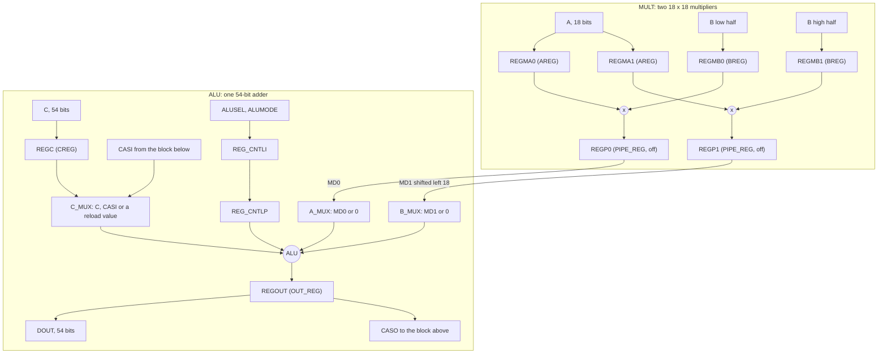
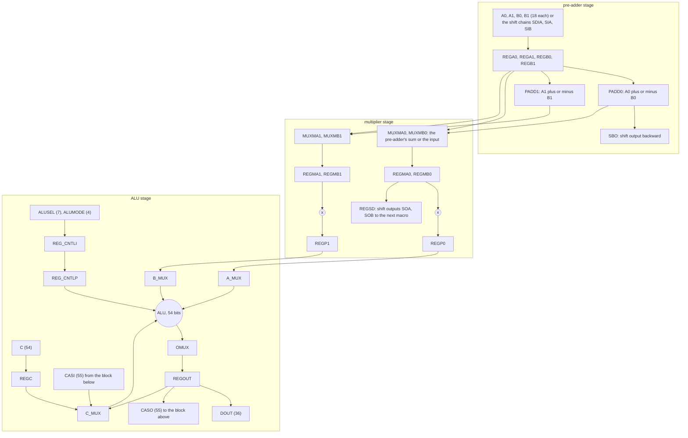
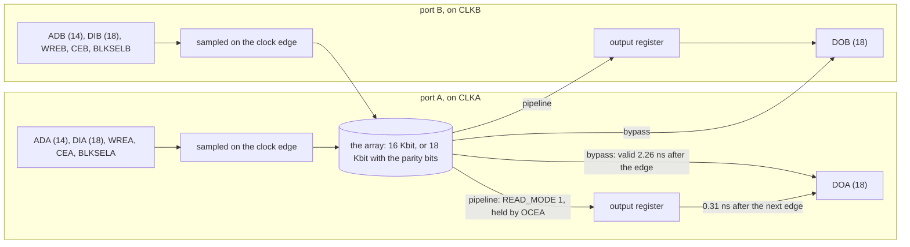
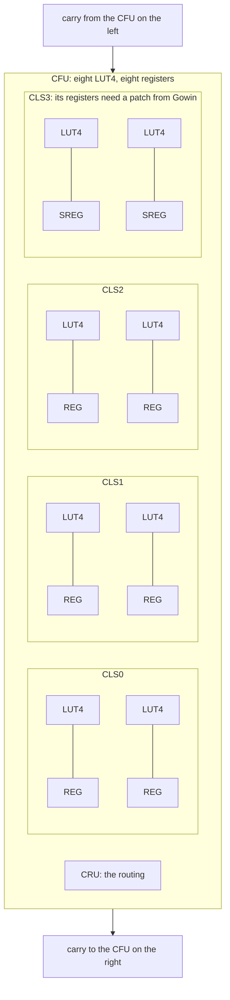

# The Gowin primitives as graphs

Copyright © 2026 Thor H. Linløkken <thj@thj.no>
License: CERN-OHL-S v2

*The block diagrams of the Gowin documents under `docs/thirdparty`,
transcribed as Mermaid graphs so that they can be read, diffed and
quoted. Each graph names its figure and the printed page; what follows
each graph is what it tells this project. The documents: DS226-2.7E (the
GW2AR data sheet), UG285-1.4E (block RAM), UG287-1.4E (DSP). The part is
the GW2AR-LV18QN88C8/I7, so the C8/I7 columns apply.*

## 1. The DSP primitive we use: MULTALU36X18

UG287-1.4E, figure 4-9, p29. The registers in parentheses are the
parameters that enable them (table 4-10, p30); the CSP's multiply-add
sets `AREG`, `BREG`, `CREG` and `OUT_REG` and leaves `PIPE_REG` off.

What it says:

- **Every pin of the block has a register behind it inside the block**:
  A and B into `REGMA`/`REGMB`, C into `REGC`, the sum out of `REGOUT`.
  The fabric's job is to deliver A, B and C to those pins before the
  clock; the multiply and the add are register to register inside the
  block.
- **The 18 × 36 product is two 18 × 18 products added**, the high one
  shifted by eighteen, in the same 54-bit adder that adds C. That is
  why `MULTALU36X18_MODE 0` is "a × b ± c" with nothing else in the
  path, and why there is no separate accumulator register: C *is* the
  accumulator input, and the sum comes out of `REGOUT`.
- **With `PIPE_REG` off**, `REGMA`/`REGMB` → multiplier → adder →
  `REGOUT` is one clock. The data sheet's 265 MHz for an 18 × 18
  multiply-add (DS226 table 3-16, p36) is for the fully registered
  case; the single-clock figure is not given. At 73.728 MHz the first
  revision measured the block itself as never the problem: what failed
  was the route from fabric registers into `REGMA`/`REGMB`.
- The clock-to-output figures (DS226 table 3-15, p36) are tiny: 0.24 ns
  from an input register, 0.04 ns from the output register. A path out
  of `DOUT` is a fabric path in all but name.

## 2. The DSP macro the primitive is cut from

UG287-1.4E, figure 3-1, p5. One DSP block holds two macros; each macro
is this. The primitives (`MULT18X18`, `MULTALU36X18`, `ALU54D`, the
pre-adders) are configurations of it.

What it says:

- **Three stages, each with its own registers**: pre-add, multiply,
  add. A design that needs one of them pays for all three in silicon
  but can bypass the registers of the ones it does not use.
- **The control inputs are registered twice** (`REG_CNTLI`,
  `REG_CNTLP`) before they reach the adder: an operation select that
  changes every cycle arrives two clocks late unless the design accounts
  for it. The CSP uses one fixed mode and never touches them.
- **The cascade** (`CASI` → `C_MUX`, `REGOUT` → `CASO`) and the shift
  chains (`SDIA`/`SIA`/`SIB` in, `SOA`/`SOB`/`SBO` out) are how a FIR
  filter is strung across macros without the fabric. The partial
  pipeline's filter does not use them; a future one could.
- **The adder's output feeds back to `C_MUX`**: an accumulator costs no
  fabric. The CSP accumulates in its own registers because the
  accumulator's value must be readable by the next instruction's
  operand select, not because the block cannot.

## 3. The block RAM as a port

UG285-1.4E has no internal block diagram, only port diagrams (figure
3-7, p13, the dual-port `DPB`/`DPX9B`; figure 3-13, p26, the semi-dual
`SDPB`/`SDPX9B`). What is inside is in the text (p6, the read modes) and
in the data sheet's timing table (DS226 table 3-14, p36); this graph is
built from those.

What it says:

- **The input pins are registers.** Address, data and write enable are
  sampled on the port's clock edge; there is no combinational path
  through a block RAM. The question for the fabric is only whether the
  logic that drives a pin settles before the edge.
- **Two clocks, no crossing.** Port A and port B each have their own
  clock. A memory written on the SPI clock and read on the system clock
  is one block, not a FIFO with synchronisers; only single bits (a
  commit, a hold) need a crossing of their own.
- **The output has two speeds.** In bypass mode the word is valid
  2.26 ns after the edge that sampled the address and then goes
  through fabric logic in the same cycle; in pipeline mode it comes out
  of the block's output register 0.31 ns after the following edge. The
  second is what the CSP uses on every read: the block's register is the
  register on the output pin.
- **"Performing read and write operations to the same address at the
  same time is not allowed"** (UG285 p6, note 1 under the dual-port
  mode). The first revision found this on the board as a lost write and
  made it a rule; the document had it all along. Idle read ports are
  parked on a row nothing writes.

## 4. The logic cell, and why the flip-flops run out first

DS226-2.7E, figure 2-2, p9: the configurable function unit.

What it says:

- **A slice is one LUT4 and one register**, four slice pairs to a unit,
  and the fourth pair's registers are "SREGs" that "need special patch
  support" (the note under the figure). The usable count is therefore
  **six registers for every eight LUTs**: 2592 units × 8 = 20 736 LUT4,
  × 6 = 15 552 flip-flops, which are the totals the place-and-route
  tool reports. This is the ratio that bit the first revision: at 52 %
  of the LUTs it was at 78 % of the flip-flops, and the legaliser could
  not place five more registers.
- **The carry chain runs across units**, left to right. An adder is
  cheap per bit and costs a LUT level in and out (`gowin_oss_notes.md`,
  section 5, rule 4).
- **The LUT is four inputs.** There is no six-input LUT and no
  dedicated wide mux: a 4:1 mux is two levels, an 8:1 three. The
  wide-function clusters (`MUX2_LUT5` … `MUX2_LUT8`) are pairs of these
  slices placed together, which is what `-nowidelut` turns off.
