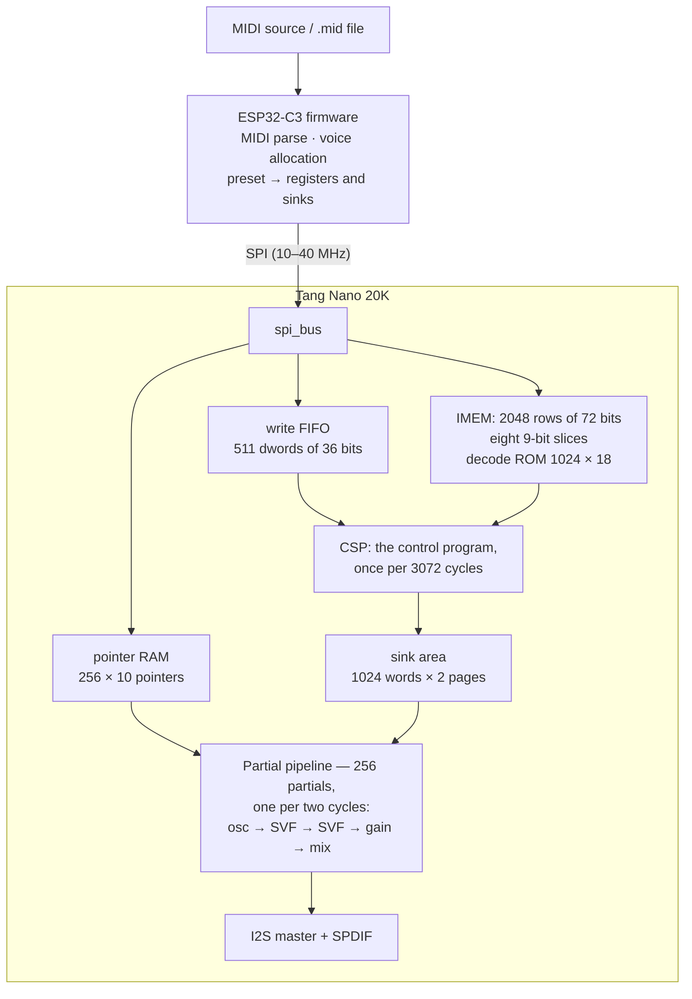

# SPI Memory Map — Noaidi Synth

Copyright © 2026 Thor H. Linløkken <thj@thj.no>
License: CERN-OHL-S v2

The ESP32-C3 ↔ FPGA SPI control interface: wire protocol, address map, and
what the words mean. The map is in `rtl/synth_pkg.sv` and
`app/main/fpga_map.hpp`; the decoder is `rtl/spi/spi_bus.sv`, and
`rtl/tb/tb_spi_bus.sv` is its bench.

## Architecture stance

The FPGA is a dumb-but-fast synthesis engine: 256 independent partials, each
an oscillator, a filter and a gain, behind a processor that computes every
control signal. It has no concept of notes, unison, polyphony, MIDI or CCs —
all of that is ESP32 firmware territory (think 256 Minimoog voice cards behind
a MIDI-to-CV converter). Consequences:

- ESP32 does voice allocation, unison grouping, CC→parameter mapping and
  velocity scaling, and expresses the results as **register and sink-word
  writes** to the CSP (`app/main/render.cpp`).
- **Envelopes, LFOs, pitch and cutoff arithmetic run in the FPGA**, as the
  control program the CSP executes once per pass (four samples, 24 kHz — #268):
  `tools/csp/programs`, in the firmware as
  `app/main/csp/control_program.hpp`. The instruction set is
  [csp2_isa.md](csp2_isa.md), the machine
  [csp2_architecture.md](csp2_architecture.md).
- A partial is **pointers only**: ten pointers into the **sink area**, which
  the CSP publishes. A voice's partials point at the voice's sinks (pitch,
  cutoff, gain) and at their channel's (detune, offset, the gain on each
  side, pulse width, resonance, mode). Which sink a partial reads is wiring,
  set when the voice layout changes.
- Note-on/off is a handful of writes to a voice's registers (its note, the
  amounts its velocity sets, its envelopes' stages: attack at note-on,
  release at note-off); the CSP steps the envelopes and ends an attack at
  full scale.

## Block diagram

## Conventions

- **The wire is in nines.** Every block RAM on the chip is 9, 18 or 36 bits
  wide, so the link is too: a command nonet, two address nonets (18 bits)
  and 36-bit payload dwords, MSB first, nothing straddling a boundary. The
  ESP32's SPI master clocks any number of bits per transfer; the slave counts
  to nine. (The first revision's 32-bit wire carried 18 useful bits in 32
  clocks and split a 36-bit instruction over a high-bits register; that is
  gone.)
- **A dword is 36 bits**: a register or sink write is one dword (`[35:24]` the
  12-bit address, `[23:6]` the 18-bit word, `[5:0]` spare); a wide register is
  two dwords, the pair's halves; an instruction row is two dwords; a decode ROM
  row is one dword with the upper half unused; a status or probe word reads
  back as one dword, 18 or 36 wide as it is.
- **Address width: 18 bits**, in dwords.
- **Transaction format**: the command nonet, the address nonet, then dwords
  while CS is low (a burst: the address increments by one dword). Command:
  `[8] R/W` (1 = read), `[7] auto-increment`, `[6:0] reserved`. A read has one
  dummy turnaround dword before the data. MISO's first nonet is always the ID
  nonet (`0x0A5`), a link check on every frame.
- **Writes outside the ranges below are dropped, reads return zero**: no
  aliasing. The ranges cannot overlap; `spi_bus` checks that at elaboration.
- **Atomicity.** A register or sink write waits in the **write queue** until
  the CTRL swap commits everything queued so far; the CSP then applies the
  committed writes at the end of its next pass, at most 48 a pass, so a
  program never sees a register change under it and a group of writes (a
  note-on) lands together. A partial's pointers are written whole, on the
  SPI clock edge that completes the entry.
- **CDC via BSRAM ports**: the SPI side writes on the sclk-clocked port and
  the system clock reads on the other; the dual-clock BSRAM *is* the
  clock-domain crossing for the pointer RAM, IMEM, the ROM and the write
  FIFO — on the one condition that the two ports are never on the same row
  at the same time (UG285-1.4E p6 and p24, note 1; `csp2_architecture.md`
  rule 2), which each of them meets by construction: the FIFO by its
  pointers, IMEM and the ROM by being loaded with the CSP held, the pointer
  RAM by a whole entry written on one SPI clock edge.

## Top-level map

Addresses are in 36-bit dwords.

| Address | Section | Size |
|---|---|---|
| `0x00000–0x0000F` | System registers (read back) | 16 dwords |
| `0x02000–0x05FFF` | Partial pointers (256 × 64) | 16K dwords |
| `0x06000` | The CSP's write FIFO's door: a dword carries its own register or sink address | 1 dword |
| `0x08000–0x08FFF` | IMEM: 2048 instruction rows, two dwords a row; a program loads only its own rows, which end with `END` (#271) | 4096 dwords |
| `0x09000–0x090FF` | The decode ROM: the 256 rows an op can name, one dword a row (the block has 1024; the last is where the decode parks) | 256 dwords |

Everything else is reserved. The regions' bases are the first revision's,
widened; the map's rule stands — firm, and landscaped where the chip asks.

## System registers — `0x0000–0x000F`

| Offset | Register | Contents |
|---|---|---|
| `0x000` | `ID` | reserved (the ID byte rides MISO byte 0 of every frame) |
| `0x001` | `STATUS` | reserved |
| `0x002` | `CTRL` | `[0]` commit the write queue (an event: write 1 to commit), `[1]` hold the CSP in reset, `[2]` replace the output with the test tone, `[3]` the data stream on the 48 kHz output, `[6:4]` its source |
| `0x003–0x006` | scratch | read back what was written |
| `0x007` | `TRAP` | written: `[10:0]` the CSP register, or with `[11]` set the sink word by index, that the write trap watches (0: none); read: what it caught — `[35:30]` the hits (mod 64), `[29]` the last was the pass's (the window's or the sink area's), `[28:18]` its cycle in the pass, `[17:0]` its word. The lab's instrument for a write nobody asked for (#238) |
| `0x008` | `DIAG_PASS` | read-only. `[17:0]` passes the CSP has run since reset (two reads a few ms apart must differ, or the CSP has stopped) |
| `0x009` | `DIAG_QUEUE` | read-only. `[9:0]` the write queue's read pointer, Gray-coded; `[10]` the queue is full |
| `0x00A` | `DIAG_LIMITER` | read-only. `[18:0]` the master limiter's envelope state (`[18:11]` is the reduction in codes of 0.375 dB, `[10:0]` the fraction; 0 = none, 255 codes = 95.6 dB) |
| `0x00B` | `DIAG_DROPPED` | read-only. `[15:0]` writes dropped because the queue was full (saturating) |
| `0x00C` | `PROBE_ADDRESS` | `[10:0]` the CSP register (an aligned pair) the probe reads once a pass; at power-up the pair at `0x05E`, in the inputs, which nothing writes |
| `0x00D` | `DIAG_PROBE_EVEN` | read-only. `[17:0]` the even register of the probed pair, as of the last pass |
| `0x00E` | `DIAG_PROBE_ODD` | read-only. `[17:0]` the odd register of the probed pair |
| `0x00F` | `DIAG_STREAM` | read-only. `[15:0]` the data stream's frames sent since reset |

The diagnostic words cross from the system clock through two flip-flops and are not coherent across bits; read twice.

`CTRL[1]` is 1 at power-up: the CSP runs no program until the firmware has
loaded one and written `CTRL = 0`. A held CSP applies every committed write in
the pass it is committed in. `CTRL` reads back its last value without the
commit bit. Every `CTRL` write sets all three bits: pass the hold and the test
tone along with a swap.

## Program — IMEM `0x08000–0x08B7F`, the decode ROM `0x09000–0x090FF`

An instruction is 72 bits ([csp2_isa.md](csp2_isa.md) section 2), held as
eight 9-bit slices of one row in eight blocks of 2048 × 9. A row is two
dwords: the first carries bits `[71:36]`, one 9-bit slice to each of the
upper four blocks, the second bits `[35:0]` to the lower four; row `pc` is
at `0x08000 + 2 pc`. The decode ROM's rows (a block of 1024 × 18 of which the word's eight-bit `op`
reaches the first 256; the operations as `csp2_isa.md` section 4 lists them) are
one dword each at `0x09000 + op`, the upper half of the dword unused. The last
row is not written: the decode parks on it while the CSP is held. Both are loaded as one image with the
CSP held: the memories take writes only then, so a pass never runs half an
old program and half a new, and instructions past the end of the program
are zero, which is `NOP`.

## Write FIFO — the door at `0x06000`

A dword written to the door queues a write of its 18-bit word (`[23:6]`) to
the register or sink word its top 12 bits (`[35:24]`) name (`0x000–0xBFF`),
as the CSP's address space has it ([csp2_isa.md](csp2_isa.md), the register
map); a batch is one frame of dwords to the door without auto-increment, in
any order of addresses, and the dword is the FIFO's entry as it is, the block
in its 512 × 36 configuration:

| `a` | What |
|---|---|
| `0x001–0x03F` | free: the first revision's constant pool; the second revision's constants are immediates in the word |
| `0x040–0x05F` | inputs (read only; a write is dropped) |
| `0x060–0x07F` | globals: the LFOs' sets, the channel count |
| `0x080–0x1FF` | the LFO pool |
| `0x200–0x5FF` | channels: 16 × 64 registers |
| `0x600–0x7FF` | voices: 32 × 16 registers |
| `0x800–0x8FF` | voice sinks (the CSP's): 32 × 8 |
| `0x900–0xBFF` | channel sinks (the firmware's, with the exceptions below): 16 × 48 |

The layout of every block is `tools/csp/programs/map.s`, the one definition;
`csp header` writes it into `app/main/csp/control_program.hpp`. Sink words the
firmware writes land on the sink area's shadow page, like the CSP's own, and
are taken over at the page flip; a partial never reads a page being written
(`csp2_architecture.md` rule 2). The CSP's own sink words are written every
pass by the program, and the firmware must not write them. A channel's duty
and resonance sinks are the program's (they move with the LFOs); the rest of
its block is the firmware's.

The FIFO holds 511 dwords (its 512th row is the one the parked reader sits
on), so a batch larger than that needs a swap and a wait between chunks. The write window applies 48 a pass, a pass being 20.8 µs:
a 1 kHz tick can send 480 and the FIFO is empty again before the next.

## The data stream — the 48 kHz S/PDIF output as a pipe

With `CTRL[3]` set, the 48 kHz S/PDIF output carries data instead of audio:
one 32-bit word a sample, the left channel's top 16 bits its high half and
the right channel's its low half, straight onto the transmitter (no
decimation average). The dev box's receiver keeps exactly those bits
(`tools/lab/spdif_capture.py`, measured bit-perfect on #233). The words
come in frames of 64 (`rtl/spdif/spdif_stream.sv`):

| word | contents |
|---|---|
| 0 | the sync word `0xB7E15A3C` |
| 1 | `[31:16]` the frame's sequence number, `[1:0]` the source |
| 2–62 | the payload, 61 words |
| 63 | the CRC-32 of words 0–62: IEEE 802.3's polynomial `0x04C11DB7`, MSB first, initial all ones, no final inversion |

The source (`CTRL[6:4]`) is taken at the sync word and holds for the frame:
0 is a 32-bit maximal LFSR (`x^32 + x^22 + x^2 + x + 1`, seed 1, stepped 32
times after every word of positions 0–62, whichever source is sent), 1 is
the pass counter, 2 is the probe's pair (its even word on the frame's even
positions, its odd word on the odd ones, 18 bits each), 3 is the engine's
view — the sink word at the probe address's low ten bits, as the partials
read it, in `[31:14]`, and the mix's top 14 bits in `[13:0]`, the left
channel on even positions and the right on odd ones: the S/PDIF output as
the debug port; 4 is the register file — the probe walks it a register a
pass, each word the register's index in `[31:21]` and its word in `[17:0]`,
the whole file in a little over 2048 samples (the probe holds its register while the word two samples on would be a header's, so none is missed; 45 ms), held or running, which is how
`chip_check.py --stream` reads a frozen chip back. A receiver that lost or repeated a sample fails
the frame's CRC and re-synchronises on the next sync word; the sequence
number says how many frames went. `DIAG_STREAM` (dword `0xF`) counts the
frames sent.

## Partial pointers — `0x2000 + 64 p`

Partial `p` (0–255) takes four words, 30 bits each, three 10-bit pointers to a
word (the first at the word's bottom). The fourth word completes the entry:
the pointers, ten in all, become the partial's together.

| Word | Bits `[9:0]` | `[19:10]` | `[29:20]` |
|---|---|---|---|
| `+0` | pitch (voice) | pitch (channel: detune) | cutoff (voice) |
| `+1` | cutoff (channel: offset) | gain (voice) | gain left (channel) |
| `+2` | gain right (channel) | duty | resonance |
| `+3` | mode | — | — |

A pointer is an index into the sink area (0–1023, the address minus
`0x800`). Every pointer is at the sink area's last word (`0xBFF`, which nobody
writes: zero) at power-up, so a partial nobody has pointed is silent.

The ten words, as the partial pipeline reads them (all Q4.14):

| Sink | Word | Effective value |
|---|---|---|
| pitch | voice + channel | octaves from middle C, plus the pipeline's reference (`0x1400`, UQ4.10): note, bend and pitch LFOs, tune and unison detune |
| cutoff | voice + channel | likewise, clamped to the flat `FC_MAX` |
| resonance | one | octaves of Q above Butterworth, never below zero |
| duty | one | pulse width, 1.0 being the rail (`2^23`) |
| gain | voice × (left, right) | all linear (#176): the voice's word is the gain itself (the envelope's level × the velocity's amount), clamped at unity, silent at zero and below; the channel's left and right are linear; the product signed, clamped to ±8.0. Loudness laws (velocity, sustain) are the firmware's, computed once |
| mode | one | `[1:0]` waveform (0 saw, 1 pulse, 2 triangle, 3 sine), `[2]` cascade (24 dB/oct), `[4:3]` filter type (0 LP, 1 BP, 2 HP) |

The partial pipeline takes two cycles a partial (512 of the sample's 768
cycles) because it reads all ten words through the sink area's six read
ports.

## Firmware conventions

- The firmware's image of the registers and sinks is `engine_link`'s: a write
  of the value already there is dropped, and what changed goes out in bursts
  of consecutive addresses, committed by one swap.
- The image is read back after boot: every register the image knows, through
  the probe, against what was sent, and the image is sent again (at most
  three times) when they differ — the write queue has lost words of the boot
  image on some boots (issue #222: the constant ONE among them, the synth
  silent for it with every self-test passing). The console logs the count
  either way, and `csp-verify`, `csp-resend` and `csp-poke … force` do the
  same by hand. The sinks (`0x800` on) cannot be read back.
- ADSR rates are 8-bit log₂ in the preset (4-bit octave + 4-bit
  1/16-octave fraction); firmware decodes them to the coefficient
  (`preset_adsr_rate_coeff`) the envelope program's rate is made from
  (`csp::envelope_rate`).
- Velocity scales the amp envelope's amount in dB (a soft note is as many dB
  down as the preset's sensitivity says: the old 60 dB span, taken as an
  amplitude by the firmware since the gain is linear) and the mod
  envelope's depth linearly. Key tracking follows each partial's own pitch
  (note, tune, unison detune) and the channel's bend and pitch LFOs.
- Controllers are one register write per event; a "global" control is a
  channel register many voices read.

## SPI speed budget

- Firmware default: **10 MHz**, one CS frame per transaction; `csp-spiclk
  <MHz>` changes it at run time.
- **Measured on hardware with the wire in nines (#233, 2026-10-18): clean at
  10, 20, 26.7 and 40 MHz** — a thousand rounds of five scratch dwords each,
  singly and in a burst, at every rate: no dword wrong and the ID nonet on
  every frame. (The ESP32 divides its 80 MHz: 30 asked gives 26.7.)
- **Measured earlier with the first revision's 32-bit wire: clean at
  every rate from 1 MHz to 40 MHz.** 88/88 transactions correct — write four registers, burst-read
  them back, check the ID byte and all four values, ×8 repetitions at each
  of 11 rates. 40 MHz is the ESP32-C3's ceiling for SPI2 through the GPIO
  matrix (the configured pins are not the IOMUX ones), not a limit of the
  link: nothing had started to degrade. The jumper wiring, suspected here
  as the likely limiter, is not one.
- nextpnr reports the `u_spi.sclk` domain closing at 230–269 MHz, so the
  slave has enormous margin; the master is the constraint at every rate.
- Raising the firmware default is therefore a free change whenever the
  traffic justifies it.
- Traffic: a note-on is a handful of words; a re-render of the preset is the
  words that changed; envelopes, LFOs, pitch and cutoff cost no SPI traffic.
  The boot is the program (two dwords a row) and the decode ROM (one a row),
  the wiring (~400 dwords; constants are immediates in the word), and 256
  pointer entries.

## Known limits vs a full polysynth

- **One oscillator per partial.** Two-oscillator features (hard sync,
  osc-level FM/ring mod) would need a second phase accumulator (pipeline +3–4
  stages). Cross-*voice* modulation is impossible in the time-division-multiplexed
  (TDM) partial pipeline — voices never see each other's state.
- **Long effects delays need external memory**: total FPGA BSRAM is
  828 kbit. A 1 s stereo delay at 96 kHz/24-bit is ~4.6 Mbit.
- **Noise oscillator** (reserved type 4+) needs a small global LFSR (#216).
- Everything else standard (glide, key tracking, pan, unison detune and
  spread, velocity curves, splits/layers, arpeggiator, chord memory,
  damper/sostenuto) is firmware-side and fully supported by this map.

## BSRAM — measured

Tested on the real toolchain (yosys 0.67, nextpnr-himbaechel,
gowin_pack, GW2AR-LV18QN88C8/I7).

| Pattern | Result |
|---|---|
| Semi dual-port, 2 clocks (write sclk / read sysclk), 2048 × 36 | **4 × `DPX9B`** — inferred, packed, bitstream emitted |
| True dual-port, 2 clocks, both ports read **and** write | **fails**: `ERROR: no valid mapping found for memory` |
| True dual-port, one clock, both ports read and write (the sink area's active block: two reads) | **not inferred**: yosys sends it to 18432 flip-flops |
| One write and two reads on one memory | two blocks, each fully written: yosys copies the memory |
| 256 × 36 | 0 blocks — yosys picks LUT-RAM below roughly a block's worth |

So a block with two read ports is **instantiated by hand**: the sink area is
six `DPX9B` (`rtl/csp/csp_sink_area.sv`), the active page's block reading on
both ports and the shadow page's taking the CSP's write on one of them, as
the multiply-add dword's DSP is. Everything else is inferred as a semi
dual-port block, one write and one read.

Place-and-route of the whole design (`make pack`): the blocks and their
ports are `csp2_architecture.md` section 2, the flow its section 4, and the
measured rules `gowin_oss_notes.md`.

### Simulation

The open-source flow's BSRAM primitives are blackboxes
(`cells_xtra_gw2a.v`): a post-synthesis simulation does not elaborate. The
benches simulate the source RTL instead, and the hand-instantiated blocks
(`DPX9B`, `MULTALU36X18`) with the vendor's behavioural models, shipped with
the Gowin IDE (`rtl/Makefile`, `GOWIN_SIM`). A plain array in a bench is not
what gets built, so a memory that is inferred still rests on "it builds" for
its mapping.

- **The 64-word per-partial stride is address space, not RAM.** Four words of
  the stride are used, in a pointer RAM of 256 entries of 100 bits.
  Instantiating the whole stride would consume most of the part's BSRAM; the
  address map's generous reservations cost nothing as long as nobody builds
  an array to match them.
