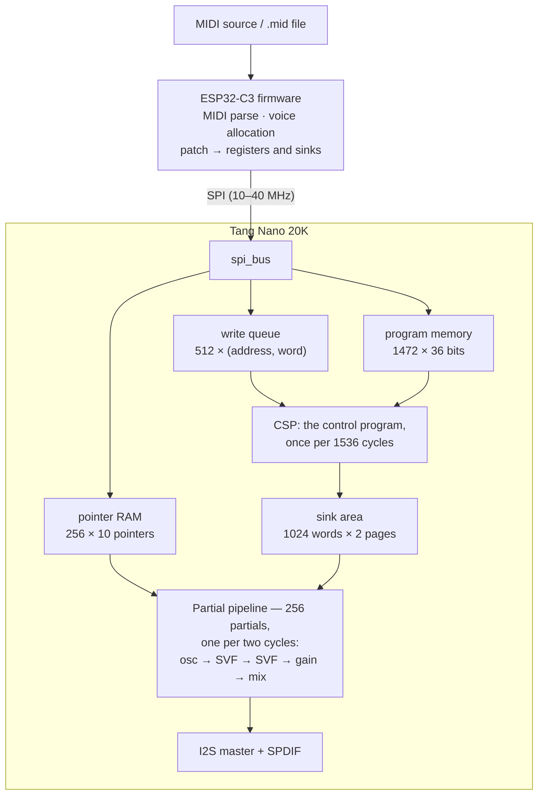

# SPI Memory Map — Noaidi Synth

Copyright © 2026 Thor H. Linløkken <thj@thj.no>
License: CERN-OHL-S v2

The ESP32-C3 ↔ FPGA SPI control interface: wire protocol, address map, and
what the words mean. The map is in `rtl/synth_pkg.sv` and
`app/main/fpga_map.hpp`; the decoder is `rtl/spi/spi_bus.sv`, and
`rtl/tb/tb_spi_bus.sv` is its bench.

## Architecture stance

The FPGA is a dumb-but-fast synthesis engine: 256 independent partials, each
an oscillator, a filter and a gain, behind a processor that computes every
control signal. It has no concept of notes, unison, polyphony, MIDI or CCs —
all of that is ESP32 firmware territory (think 256 Minimoog voice cards behind
a MIDI-to-CV converter). Consequences:

- ESP32 does voice allocation, unison grouping, CC→parameter mapping and
  velocity scaling, and expresses the results as **register and sink-word
  writes** to the CSP (`app/main/render.cpp`).
- **Envelopes, LFOs, pitch and cutoff arithmetic run in the FPGA**, as the
  control program the CSP executes once per pass (two samples, 48 kHz):
  `tools/csp/programs`, in the firmware as
  `app/main/csp/control_program.hpp`. The instruction set is
  [csp_manual.md](csp_manual.md), the design [csp_isa.md](csp_isa.md).
- A partial is **pointers only**: ten pointers into the **sink area**, which
  the CSP publishes. A voice's partials point at the voice's sinks (pitch,
  cutoff, gain) and at their channel's (detune, offset, the gain on each
  side, pulse width, resonance, mode). Which sink a partial reads is wiring,
  set when the voice layout changes.
- Note-on/off is a handful of writes to a voice's registers (its note, the
  amounts its velocity sets, the gate); the envelopes watch the gate.

## Block diagram

## Conventions

- **Register width: 32 bits on the wire.** A register or sink word is 18 bits,
  Q4.14 (the low 18 bits of the wire word); a program word is 36 bits, the
  high four through `PROGRAM_HIGH`.
- **Address width: 16 bits** (word addresses).
- **Transaction format**: 1 command byte + 2 address bytes + 4 data bytes per
  word, MSB first. Command: `[7] R/W` (1 = read), `[6] auto-increment
  (burst)`, `[5:0] reserved`. A read has two dummy turnaround bytes before the
  data. A burst streams words while CS is low. MISO byte 0 is always the ID
  byte (`0xA5`), a link check on every frame.
- **Writes outside the ranges below are dropped, reads return zero**: no
  aliasing. The ranges cannot overlap; `spi_bus` checks that at elaboration.
- **Atomicity.** A register or sink write waits in the **write queue** until
  the CTRL swap commits everything queued so far; the CSP then applies the
  committed writes at the end of its next pass, at most 48 a pass, so a
  program never sees a register change under it and a group of writes (a
  note-on) lands together. A partial's pointers are written whole, on the
  SPI clock edge that completes the entry.
- **CDC via BSRAM ports**: the SPI side writes on the sclk-clocked port and
  the system clock reads on the other; the dual-clock BSRAM *is* the
  clock-domain crossing for the pointer RAM and the write queue.

## Top-level map

| Address | Section | Size |
|---|---|---|
| `0x0000–0x000F` | System registers (read back) | 16 words |
| `0x0010` | `PROGRAM_HIGH` (write only) | 1 word |
| `0x2000–0x5FFF` | Partial pointers (256 × 64) | 16K words |
| `0x6000–0x6FFF` | The CSP's write queue: register or sink word at `0x6000 + a` | 4K words |
| `0x8000–0x85BF` | The CSP's program memory (1472 instructions) | 1472 words |

Everything else is reserved.

## System registers — `0x0000–0x000F`

| Offset | Register | Contents |
|---|---|---|
| `0x000` | `ID` | reserved (the ID byte rides MISO byte 0 of every frame) |
| `0x001` | `STATUS` | reserved |
| `0x002` | `CTRL` | `[0]` commit the write queue (an event: write 1 to commit), `[1]` hold the CSP in reset, `[2]` replace the output with the test tone |
| `0x003–0x007` | scratch | read back what was written |
| `0x008` | `DIAG_PASS` | read-only. `[17:0]` passes the CSP has run since reset (two reads a few ms apart must differ, or the CSP has stopped) |
| `0x009` | `DIAG_QUEUE` | read-only. `[9:0]` the write queue's read pointer, Gray-coded; `[10]` the queue is full |
| `0x00A` | `DIAG_LIMITER` | read-only. `[18:0]` the master limiter's envelope state (`[18:11]` is the reduction in codes of 0.375 dB, `[10:0]` the fraction; 0 = none, 255 codes = 95.6 dB) |
| `0x00B` | `DIAG_DROPPED` | read-only. `[15:0]` writes dropped because the queue was full (saturating) |
| `0x00C` | `PROBE_ADDRESS` | `[10:0]` the CSP register (an aligned pair) the probe reads once a pass |
| `0x00D` | `DIAG_PROBE_EVEN` | read-only. `[17:0]` the even register of the probed pair, as of the last pass |
| `0x00E` | `DIAG_PROBE_ODD` | read-only. `[17:0]` the odd register of the probed pair |
| `0x00F` | — | reads zero |

The diagnostic words cross from the system clock through two flip-flops and are not coherent across bits; read twice.

`CTRL[1]` is 1 at power-up: the CSP runs no program until the firmware has
loaded one and written `CTRL = 0`. A held CSP applies every committed write in
the pass it is committed in. `CTRL` reads back its last value without the
commit bit. Every `CTRL` write sets all three bits: pass the hold and the test
tone along with a swap.

## Program — `PROGRAM_HIGH`, `0x8000–0x85BF`

An instruction is 36 bits (`csp_manual.md` section 4). Write bits 35:32 to
`PROGRAM_HIGH`, then bits 31:0 to `0x8000 + pc`; the instruction is written
with the high bits last written. The memory takes writes only while the CSP is
held, so a pass never runs half an old program and half a new. Instructions
past the end of the program are zero, which is `NOP`.

## Write queue — `0x6000–0x6FFF`

A word written to `0x6000 + a` queues a write of its low 18 bits to register
or sink word `a` (`0x000–0xBFF`), as the CSP's address space has it
([csp_isa.md](csp_isa.md) section 5):

| `a` | What |
|---|---|
| `0x001–0x03F` | constants (the program's `.const`s, written once) |
| `0x040–0x05F` | inputs (read only; a write is dropped) |
| `0x060–0x07F` | globals: the LFOs' sets, the channel count |
| `0x080–0x1FF` | the LFO pool |
| `0x200–0x5FF` | channels: 16 × 64 registers |
| `0x600–0x7FF` | voices: 32 × 16 registers |
| `0x800–0x8FF` | voice sinks (the CSP's): 32 × 8 |
| `0x900–0xBFF` | channel sinks (the firmware's, with the exceptions below): 16 × 48 |

The layout of every block is `tools/csp/programs/map.s`, the one definition;
`csp header` writes it into `app/main/csp/control_program.hpp`. Sink words the
firmware writes go to both pages of the sink area, so they survive the page
flip at the end of a pass; the CSP's own sink words are written every pass by
the program, and the firmware must not write them. A channel's duty and
resonance sinks are the program's (they move with the LFOs); the rest of its
block is the firmware's.

The queue holds 512 writes, so a burst larger than that needs a swap and a
wait between chunks. The write window applies 48 a pass, a pass being 20.8 µs:
a 1 kHz tick can send 480 and the queue is empty again before the next.

## Partial pointers — `0x2000 + 64 p`

Partial `p` (0–255) takes four words, 30 bits each, three 10-bit pointers to a
word (the first at the word's bottom). The fourth word completes the entry:
the pointers, ten in all, become the partial's together.

| Word | Bits `[9:0]` | `[19:10]` | `[29:20]` |
|---|---|---|---|
| `+0` | pitch (voice) | pitch (channel: detune) | cutoff (voice) |
| `+1` | cutoff (channel: offset) | gain (voice) | gain left (channel) |
| `+2` | gain right (channel) | duty | resonance |
| `+3` | mode | — | — |

A pointer is an index into the sink area (0–1023, the address minus
`0x800`). Every pointer is at the sink area's last word (`0xBFF`, which nobody
writes: zero) at power-up, so a partial nobody has pointed is silent.

The ten words, as the partial pipeline reads them (all Q4.14):

| Sink | Word | Effective value |
|---|---|---|
| pitch | voice + channel | octaves from middle C, plus the pipeline's reference (`0x1400`, UQ4.10): note, bend and pitch LFOs, tune and unison detune |
| cutoff | voice + channel | likewise, clamped to the flat `FC_MAX` |
| resonance | one | octaves of Q above Butterworth, never below zero |
| duty | one | pulse width, 1.0 being the rail (`2^23`) |
| gain | voice × (left, right) | linear, signed, clamped to ±8.0 |
| mode | one | `[1:0]` waveform (0 saw, 1 pulse, 2 triangle, 3 sine), `[2]` cascade (24 dB/oct), `[4:3]` filter type (0 LP, 1 BP, 2 HP) |

The partial pipeline takes two cycles a partial (512 of the sample's 768
cycles) because it reads all ten words through the sink area's six read
ports.

## Firmware conventions

- The firmware's image of the registers and sinks is `engine_link`'s: a write
  of the value already there is dropped, and what changed goes out in bursts
  of consecutive addresses, committed by one swap.
- The image is read back after boot: every register the image knows, through
  the probe, against what was sent, and the image is sent again (at most
  three times) when they differ — the write queue has lost words of the boot
  image on some boots (issue #222: the constant ONE among them, the synth
  silent for it with every self-test passing). The console logs the count
  either way, and `csp-verify`, `csp-resend` and `csp-poke … force` do the
  same by hand. The sinks (`0x800` on) cannot be read back.
- ADSR rates are 8-bit log₂ in the patch (4-bit octave + 4-bit
  1/16-octave fraction); firmware decodes them to the coefficient
  (`patch_adsr_rate_coeff`) the envelope program's rate is made from
  (`csp::envelope_rate`).
- Velocity scales the amp envelope's amount in dB (a soft note is as many dB
  down as the patch's sensitivity says: the old 60 dB span) and the mod
  envelope's depth linearly. Key tracking follows each partial's own pitch
  (note, tune, unison detune) and the channel's bend and pitch LFOs.
- Controllers are one register write per event; a "global" control is a
  channel register many voices read.

## SPI speed budget

- Firmware default: **10 MHz**, one CS frame per transaction.
- **Measured on hardware: clean at every rate from 1 MHz to
  40 MHz.** 88/88 transactions correct — write four registers, burst-read
  them back, check the ID byte and all four values, ×8 repetitions at each
  of 11 rates. 40 MHz is the ESP32-C3's ceiling for SPI2 through the GPIO
  matrix (the configured pins are not the IOMUX ones), not a limit of the
  link: nothing had started to degrade. The jumper wiring, suspected here
  as the likely limiter, is not one.
- nextpnr reports the `u_spi.sclk` domain closing at 230–269 MHz, so the
  slave has enormous margin; the master is the constraint at every rate.
- Raising the firmware default is therefore a free change whenever the
  traffic justifies it.
- Traffic: a note-on is a handful of words; a re-render of the patch is the
  words that changed; envelopes, LFOs, pitch and cutoff cost no SPI traffic.
  The boot is the program (82 words ×2), the constants and the wiring
  (~400 words), and 256 pointer entries.

## Known limits vs a full polysynth

- **One oscillator per partial.** Two-oscillator features (hard sync,
  osc-level FM/ring mod) would need a second phase accumulator (pipeline +3–4
  stages). Cross-*voice* modulation is impossible in the time-division-multiplexed
  (TDM) partial pipeline — voices never see each other's state.
- **Long effects delays need external memory**: total FPGA BSRAM is
  828 kbit. A 1 s stereo delay at 96 kHz/24-bit is ~4.6 Mbit.
- **Noise oscillator** (reserved type 4+) needs a small global LFSR (#216).
- Everything else standard (glide, key tracking, pan, unison detune and
  spread, velocity curves, splits/layers, arpeggiator, chord memory,
  damper/sostenuto) is firmware-side and fully supported by this map.

## BSRAM — measured

Tested on the real toolchain (yosys 0.67, nextpnr-himbaechel,
gowin_pack, GW2AR-LV18QN88C8/I7).

| Pattern | Result |
|---|---|
| Semi dual-port, 2 clocks (write sclk / read sysclk), 2048 × 36 | **4 × `DPX9B`** — inferred, packed, bitstream emitted |
| True dual-port, 2 clocks, both ports read **and** write | **fails**: `ERROR: no valid mapping found for memory` |
| True dual-port, one clock, both ports read and write (the sink area's active block: two reads) | **not inferred**: yosys sends it to 18432 flip-flops |
| One write and two reads on one memory | two blocks, each fully written: yosys copies the memory |
| 256 × 36 | 0 blocks — yosys picks LUT-RAM below roughly a block's worth |

So a block with two read ports is **instantiated by hand**: the sink area is
six `DPX9B` (`rtl/csp/csp_sink_area.sv`), the active page's block reading on
both ports and the shadow page's taking the CSP's write on one of them, as
the multiply-add unit's DSP is. Everything else is inferred as a semi
dual-port block, one write and one read.

Place-and-route of the whole design (`make pack`): see `docs/csp_isa.md`
section 10 for the blocks and the clock closings.

### Simulation

The open-source flow's BSRAM primitives are blackboxes
(`cells_xtra_gw2a.v`): a post-synthesis simulation does not elaborate. The
benches simulate the source RTL instead, and the hand-instantiated blocks
(`DPX9B`, `MULTALU36X18`) with the vendor's behavioural models, shipped with
the Gowin IDE (`rtl/Makefile`, `GOWIN_SIM`). A plain array in a bench is not
what gets built, so a memory that is inferred still rests on "it builds" for
its mapping.

- **The 64-word per-partial stride is address space, not RAM.** Four words of
  the stride are used, in a pointer RAM of 256 entries of 100 bits.
  Instantiating the whole stride would consume most of the part's BSRAM; the
  address map's generous reservations cost nothing as long as nobody builds
  an array to match them.
