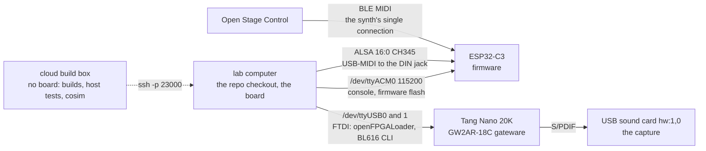

# The lab: driving the board from a shell

Copyright © 2026 Thor H. Linløkken <thj@thj.no>
License: CERN-OHL-S v2

What a new agent (or a new pair of hands) needs to know before touching the
board, so none of it has to be rediscovered by grepping. The scripts below
each carry their own docstring; this is the index and the facts around them.

## Where things are

- The board lives on the lab computer (`ssh -p 23000 thor@home.thj.no`, repo at
  `~/Documents/Code/noaidi-fpga-synth`). Flashing and chip tests run there;
  the cloud box has no board.
- **Two USB devices, two jobs.** `/dev/ttyACM0` is the ESP32's console and
  firmware port. `/dev/ttyUSB0`/`1` are the FPGA's FTDI: gateware loads
  (`make sram` volatile, `make flash` persistent) and the BL616 clock CLI
  (`board_clock.py`). Loading gateware does not touch the console port.
- **The console port must be free.** `make fw-console` (screen) and
  `make fw-monitor` hold it; `board.py`, `make fw-flash` and the storage
  targets need it. `lsof /dev/ttyACM0` says who has it. Detach a screen with
  Ctrl-A D; never `fuser -k` (it kills your own session).
- Scratch, logs and results go under `~/.local/tmp/claude`, never `/tmp`.

## Talking to the console

`python3 tools/lab/board.py "cmd" ["cmd" ...]` sends console commands and
prints the replies (each gets a two-second window). The commands that matter
for diagnosis, with what their output does and does not mean:

| command | gives | caveat |
|---|---|---|
| `csp-diag` | passes, queue, limiter, `dropped`, stream frames | `passes ÷ 48000` is the FPGA's uptime in seconds since the bitstream loaded: it dates the last gateware load (the counter runs held or not, 32-bit, wraps at 24.9 h, survives ESP32 resets). `dropped` counts only writes refused at a full queue door. |
| `csp-voices` | the firmware's voice table | a stuck note showing **HELD** never got its note-off (firmware side); all **idle** while the chip still sounds is a chip-side loss. |
| `csp-verify` | registers whose chip value differs from the firmware's image | it compares **program-owned** words too (envelope levels and stages, LFO phases and outputs, channel scratch, `PARITY`), which legitimately move; after any note it reports dozens. It lists only the first **24** by address. Read it through `verify_filter.py`. |
| `csp-peek <reg> [count]` | register pairs, `0x000–0x7FF` | the sinks `0x800–0xBFF` **cannot be read back** at all; a peek there returns nothing. |
| `csp-trap <reg>` / `csp-trap 0x8xx` / `csp-trap` | arm the write trap on a register or a sink word; read `hits, last cycle, word, by the pass or by the core` | a firmware-owned word written "by the core" is the program writing where only the firmware should: the mis-addressed write, with its cycle. The writer field means nothing at `hits 0`. |
| `csp-resend` | the whole image sent again | this is `resend_all`. A **patch reload is not a resend**: `EngineImage::set` skips words whose value did not change, so a word corrupted on the chip survives a reload of the same patch. |

Storage: `make fw-storage-read DIR=x` pulls the FAT partition (patches,
banks) into a folder, `fw-storage-write` the other way; both need the console
port. The synth's own patch saves are bare TOML without the copyright header
(#246), so port values rather than overwriting a Factory file.

## MIDI into the synth

- **USB → DIN (use this).** The CH345 adapter is ALSA `16:0`, cabled into the
  DIN jack. `aseqsend -p 16:0 "90 3C 64"` — the hex bytes are the
  **positional** argument; `-s` means "send this *file*". Several messages may
  go in one call as one byte stream. Send Active Sensing (`FE`) every quarter
  second during a session, as a keyboard does, or the parser declares the
  line silent after 500 ms and resets. `baseline_recording.py` is the model.
- **BLE is Open Stage Control's.** The synth accepts one BLE connection; the
  BLE-era scripts in `tools/lab/ble/` (`ble_midi_fuzz.py`, `hil.py`, the
  `*_check.py` tests that import it) take it over and must disconnect *and
  untrust* afterwards. Do not
  use them while OSC is connected. They need `alsa_midi`, which on the lab box
  lives in `~/.noaidi-blenv` (`~/.noaidi-blenv/bin/python`); the system python
  does not have it.
- **Never drive MIDI into the synth while anyone is playing it** — it plays
  over them and moves their controllers. Controllers cannot be read back, so
  the only true restore is a Program Change that reloads the patch
  (`midi_soak.py --program N`; `baseline_recording.py` uses program 1).

## The scripts

Board, acceptance and measurement (`tools/lab/`):

| script | what |
|---|---|
| `board.py` | console commands in, replies out (above) |
| `acceptance.py` | the three acceptances of a bitstream on the board, as one run (#238) |
| `chip_check.py` | the chip check's board half: the co-simulation's method on silicon (#235) |
| `board_clock.py` | the board's system clock from the BL616 CLI on `/dev/ttyUSB1`, no rebuild |
| `baseline_recording.py` | the fixed scales-and-triad MIDI sequence on a chosen patch, recorded over S/PDIF |
| `baseline_check.py` | that recording against what it should hold, with Essentia |
| `benchmark_compare.py` | a baseline recording against the benchmark take |
| `spdif_capture.py` | the S/PDIF output as a data pipe: capture and judge bit-exactness |
| `lab_sweep_plot.py` | the clock sweep as a graph: each device's miss rate against the clock (#241) |
| `console_logger.sh` | the always-on console witness: logs `/dev/ttyACM*` to a file |
| `publish_capture.sh` | publish a capture to the rolling GitHub release, for listening review on a phone |

The netlist gates and inspections (`pin_audit`, `check_timing`,
`synth_report`, `pin_distance`, `placement_check`) are not lab tools and live
in `tools/netlist/`; `tools/README.md` has the rule that decides a folder.

Hunting a silent write loss (#248):

| script | what |
|---|---|
| `verify_filter.py` | `csp-verify` classified by owner from `map.s`; only firmware-owned differences are real drift (exit 2). Re-read a hit after two seconds: a word caught mid-flight clears, a loss persists. |
| `midi_soak.py` | random chords and knob walks with ~150-CC sweep bursts over USB→DIN, every delay jittered (a fixed-timing bench hides timing faults), seed printed to replay; `--program N` restores the patch |
| `monitor.sh` | `verify_filter.py` on a loop while a soak plays, re-reading any real hit |

Hardware checks over BLE and the audio captures (`tools/lab/ble/` — written
during BLE development, dormant since, kept for when they are useful again):
`hil.py` (the harness), `ble_midi_fuzz.py`, `shakedown_check.py`, `voice_cycle_check.py`,
`lfo_cutoff_check.py`, `vel_amount_check.py`, `vel_modenv_check.py`,
`modenv_uniformity_check.py`, `bus_source_check.py`, `mash_check.py`,
`filter_pain_check.py`, `pain_capture.py`, `hil_filter_imd.py`,
`hil_limiter_rms.py`, `audio_level_meter.py`, `audio_purity_check.py`,
`spdif48_first_light.py`. Each says what it measures in its docstring.

## Pitfalls that have cost a night

- A wait loop of the form `while pgrep -f "soak|monitor"` matches **its own
  shell** and never exits. Test the PIDs (`kill -0`) or anchor the pattern.
- Do not run the Verilator cosim and an ESP-IDF build at once on the lab
  computer: together they exceed its RAM, and the thrash breaks the USB
  passthrough before anything else. Swap only makes it slower.
- GitHub comment bodies go through a quoted file (`-F body=@file`), never an
  unquoted heredoc: backticks get command-substituted and vanish.
- Background a long remote job with its stdin and stdout detached
  (`nohup … </dev/null >log 2>&1 &`), or the SSH session waits on it.
